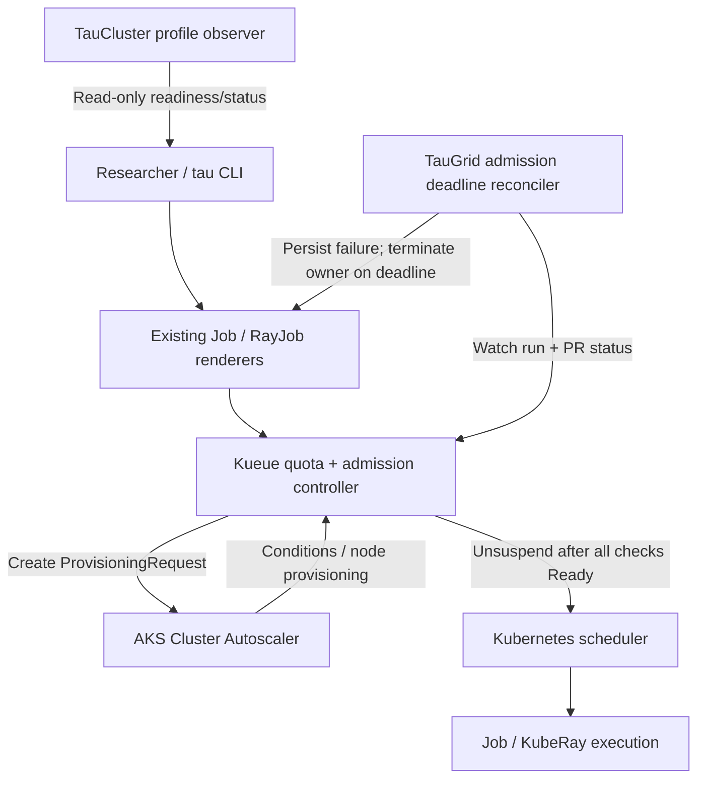

# Capacity-aware Kueue admission with Cluster Autoscaler

Status: **proposal, revised after PR #301 review.** Implementation is a follow-up.

GitHub: [#278](https://github.com/Azure/taugrid/issues/278), [PR #301](https://github.com/Azure/taugrid/pull/301)

Scope: Make Kueue admission sensitive to node capacity that Cluster Autoscaler (CA) must provision. Researchers continue to use `tau run`, `tau run status --watch`, and `tau run cancel`. Platform operators configure queue/flavor gates. TauGrid does not provision node pools directly.

Primary integration: **AKS managed Cluster Autoscaler**, Kueue 0.19.2 ProvisioningRequest AdmissionCheck, and `best-effort-atomic-scale-up.autoscaling.x-k8s.io`. A stub provisioner is used for CI, with a real AKS CPU scale-from-zero E2E lab required to verify the cloud path.

This is a **workflow, status, and lifecycle design**, not a new scheduler or cluster-autoscaler implementation. In particular, a Kueue quota reservation is not proof that nodes can be created, and CA's `Provisioned=True` does not guarantee that every pod has already been scheduled or is Ready.

## Decisions

| # | Decision | Consequence |
|---|---|---|
| D1 | Reuse Kueue's native ProvisioningRequest AdmissionCheck (`kueue.x-k8s.io/provisioning-request`). | TauGrid does not create or set status on ProvisioningRequests. |
| D2 | No new researcher `tau.yaml` fields in v1. | Capacity admission is a platform queue/flavor policy. |
| D3 | No new execution target. | Remain `singleCluster`; do not introduce `executionTarget: provisioning`. |
| D4 | MultiKueue and ProvisioningRequest checks remain disjoint on a ClusterQueue. | Cross-cluster provisioning is out of v1. |
| D5 | Default installation stays quota-only. | Explicit Helm/operator opt-in is required. |
| D6 | First AKS class: `best-effort-atomic-scale-up.autoscaling.x-k8s.io`. | `check-capacity` alone cannot support scale-from-zero. |
| D7 | Never infer a terminal provisioning failure solely from a transient AdmissionCheck `Rejected`. | Watch uses durable Workload/run conditions, with explicit provisioning context. |
| D8 | Preserve Ray head system affinity; workers use a separate compatible scalable pool/flavor. | Validate actual flavor assignments and generated PR templates with the unchanged renderer before claiming v1 support. |
| D9 | Provisioning waits must have a server-enforced deadline independent of Kueue's retryStrategy. | A minimal TauGrid lifecycle controller persists failure, terminates owner, and verifies cleanup. |

---

## 1. Context

### 1.1 User problem

TauGrid submits suspended Jobs and RayJobs through Kueue using quota, ResourceFlavors, topology, and priority. Logical quota does not prove AKS can create the corresponding physical nodes. A workload may be admitted and partially scheduled while CA scales up, with no bounded admission result. Multi-node RayJobs are especially sensitive to partial capacity.

The design gates admission on provisionable capacity, communicates quota/provisioning/scheduling separately, and ensures that non-progressing runs do not reserve Kueue quota forever.

### 1.2 Existing architecture and verified behavior

| Area | Current behavior / code |
|---|---|
| Job rendering | [`cli/internal/jobrender/render.go`](../../cli/internal/jobrender/render.go) emits suspended Job with `kueue.x-k8s.io/queue-name`. |
| Ray rendering | [`cli/internal/rayjobrender/render.go`](../../cli/internal/rayjobrender/render.go) emits suspended RayJob and queue label. Head has `topology.SystemNodeAffinity()`, workers use `mergeSelectors(plan.NodeSelector, o.NodeSelector)`. |
| Kueue dependency | [`charts/taugrid/Chart.yaml`](../../charts/taugrid/Chart.yaml) / values pin Kueue 0.19.2. |
| MultiKueue | Dedicated readiness and disjoint wiring checks already exist in [`workload_profile_observer.go`](../../controllers/tau-core/internal/controller/workload_profile_observer.go). |
| Startup status | [`core/status/phases.go`](../../core/status/phases.go) handles Kueue, MultiKueue, RayCluster, and pod lifecycle. |
| Watch regression | [`cli/internal/cli/run_lifecycle_test.go`](../../cli/internal/cli/run_lifecycle_test.go) verifies generic rejected checks do not terminate watch. |
| Node pools | AKS Terraform supports GPU autoscaling and zero minimum node count; pool maximum and cloud quota still constrain provisionability. |

### 1.3 Upstream contract and caveats

Kueue first reserves quota, then its provisioning AdmissionCheck controller creates a namespaced `autoscaling.x-k8s.io` ProvisioningRequest (PR), composed of the required pod sets. A compatible CA reconciles the PR. Kueue marks the check Ready when the provisioning conditions permit, and final admission occurs only when all required checks are Ready.

The exact condition transitions are important:

- A provisioning AdmissionCheck `Rejected` is **transient** in the pinned Kueue integration: rejection can deactivate the Workload and reset that check to `Pending`. A polling status watch can miss `Rejected` altogether.
- AKS can repeatedly return PR `Provisioned=False`, reason `CapacityIsNotFound`, when node pool `max_count` is insufficient. That is **not equivalent** to PR `Failed=True` or `BookingExpired=True`; Kueue's configured retry count need not advance, and quota can remain reserved indefinitely.
- CA provisioning completion does not guarantee pod binding or Ray worker readiness. Post-admission scheduling and startup remain separate lifecycle stages.

References: [Kueue ProvisioningRequest integration](https://kueue.sigs.k8s.io/docs/concepts/admission_check/provisioning_request/) and [AKS Kueue with Cluster Autoscaler](https://learn.microsoft.com/en-us/azure/aks/configure-kueue-with-cluster-autoscaler).

---

## 2. Supported Cluster Autoscaler environment

| Environment | v1 role | Limitation |
|---|---|---|
| AKS managed CA, autoscaled user node pool | Primary E2E integration | Confirm provisioning class compatibility, pool min/max, cloud quota, and actual pool labels. |
| Kind + compatible CA | Local exploratory recipe | A node-group implementation and provisioning support must be present; vanilla Kind is not sufficient. |
| Stub PR condition controller | Deterministic CI tests | Does not prove real scaling or cloud capacity. |
| Karpenter / alternative provider | Future integration | Provisioning class and failure behavior differ. |
| Classic CA reacting only to Pending pods | Legacy fallback, not feature-complete | Kueue already admits before scale-up. |

Use the AKS-documented `best-effort-atomic-scale-up.autoscaling.x-k8s.io` class. `check-capacity.autoscaling.x-k8s.io` only evaluates existing capacity and is not sufficient for zero-node worker pools. An autoscaled pool and correct flavor labels are necessary but not sufficient: the relevant ClusterQueue must also bind the AdmissionCheck.

---

## 3. User experience and system contract

### 3.1 Researcher

No new per-run provisioning configuration:

```yaml
name: train
engine: rayjob
entrypoint: train.py
compute:
  workers: 2
  gpus_per_worker: 1
policy:
  gpu_class: any
```

Commands are unchanged:

```bash
tau run --config tau.yaml
tau run status train --watch
tau run cancel train
```

Illustrative status:

```text
Startup phases:
  ✓ Submitted                 Job/RayJob applied
  ✓ Kueue quota reservation   2 GPUs held
  … Capacity provisioning     CA request pending; attempt 1
  · Pod scheduling            waiting for admission
```

A terminal capacity failure has a durable run result (for example `ProvisioningDeadlineExceeded`) that a newly started `--watch` can observe even after cleanup. The CLI does not equate every deactivated Workload with a terminal provisioning failure. Cancel requests terminate the owner workload, release reservations via Kueue, and initiate PR cleanup; completion of cloud node scale-down may occur later.

### 3.2 Platform administrator

Operators enable a CPU or GPU autoscaling pool; configure compatible flavors, quotas, and queue AdmissionChecks; verify provisioner readiness; and opt in the capacity gate. Profiles that reference an unhealthy check fail closed, while quota-only profiles continue their existing behavior. MultiKueue and provisioning checks cannot be attached to the same ClusterQueue.

### 3.3 State contract

| State | Kueue quota | CA state | TauGrid output |
|---|---|---|---|
| Queue wait | Not reserved | None | Waiting for quota |
| Quota reserved | Reserved | PR pending | Provisioning capacity |
| Retry / requeue | Per Kueue transitions | Failed/expired attempt | Retrying; do not mislabel terminal |
| Provisioned | Reserved | `Provisioned=True` | Capacity check Ready, then admitted |
| Admitted but pods pending | Reserved | May have provisioned nodes not yet ready | Scheduling pending, not running |
| Persistent deactivation with terminal provisioning reason | Released/releasing | Failure cleanup | Failed; `--watch` exits |
| Overall deadline exceeded | Released/releasing after owner termination | PR cleanup | Failed (`ProvisioningDeadlineExceeded`); late watch exits |
| Cancelled | Released/releasing | PR cleanup | Cancelled; cleanup observable |

**Two independent clocks:** CA/Kueue native attempts, and a persisted TauGrid **overall admission deadline** that cannot be reset by repeated `Provisioned=False` updates, check resets, polling restarts, or controller restarts.

---

## 4. Ownership boundaries



| Component | Owns | Does not own |
|---|---|---|
| Tau CLI/renderers | User intent, suspended native workload, status, cancel | ProvisioningRequest creation or direct node scaling |
| TauCluster observer | Validate queue/check/config wiring; publish readiness | PR status mutations, cloud provisioning |
| Kueue | Quota, flavors, admission, Workload/PR association, native retries | Provider node provisioning |
| Cluster Autoscaler | Evaluate PR, request nodes, PR conditions and booking | Queue policy, application status |
| Kubernetes scheduler | Bind admitted pods to nodes | Group-level queue quota |
| KubeRay | Ray head/worker runtime and recovery | Global queue admission |
| **TauGrid admission deadline reconciler (new)** | Persist overall deadline and terminal result, terminate owner, verify release | Set CA PR `Failed` or Kueue AdmissionCheck `Rejected`; create nodes |

The lifecycle reconciler is an intentionally small exception to the original observation-only scope, required for a bounded failure guarantee. It must use TauGrid-owned durable status keyed by run UID (a retained Run status resource or an equivalent durable store). The exact storage vehicle is an implementation decision; deletion of the Job/RayJob alone must not erase the user-visible terminal reason.

---

## 5. End-to-end sequence

### 5.1 Success

```mermaid
sequenceDiagram
  participant U as Researcher
  participant T as TauGrid CLI
  participant K as Kueue
  participant CA as Cluster Autoscaler
  participant KS as Kubernetes scheduler
  U->>T: tau run
  T->>K: Suspended Job/RayJob + queue label
  K->>K: QuotaReserved=True
  K->>CA: ProvisioningRequest with required pod sets
  CA->>CA: Simulate/create matching worker nodes
  CA-->>K: Provisioned=True
  K->>K: AdmissionCheck Ready; Workload Admitted
  K->>KS: Unsuspend workload
  KS-->>U: Bind pods; training begins after runtime ready
```

### 5.2 Nonterminal `CapacityIsNotFound` and bounded failure

```mermaid
sequenceDiagram
  participant K as Kueue
  participant CA as AKS CA
  participant L as TauGrid lifecycle reconciler
  participant R as Durable run status
  K->>CA: PR for unsatisfied pod sets
  CA-->>K: Provisioned=False / CapacityIsNotFound
  Note over K,CA: May repeat without Failed=True or retry exhaustion
  L->>L: Observe persistent quota hold and wall-clock deadline
  alt Provisioned before deadline
    CA-->>K: Provisioned=True
    K->>K: Admit
  else Admission deadline elapsed
    L->>R: Persist ProvisioningDeadlineExceeded (run UID)
    L->>K: Delete/terminate owner Job or RayJob
    K->>K: Release quota; garbage-collect PR
    L->>R: Update cleanup status after verification
  end
```

Cancellation and timeout can race with success. Once a durable terminal cancellation/timeout intent is committed, later CA success must not reverse TauGrid's terminal result. Reconcile using immutable run UID and current resource versions; delete owner idempotently.

---

## 6. API and configuration examples

### 6.1 Native ProvisioningRequestConfig and AdmissionCheck

```yaml
apiVersion: kueue.x-k8s.io/v1beta2
kind: ProvisioningRequestConfig
metadata:
  name: taugrid-cas-cpu
spec:
  provisioningClassName: best-effort-atomic-scale-up.autoscaling.x-k8s.io
  managedResources: [cpu, memory]
  retryStrategy:
    backoffLimitCount: 2
    backoffBaseSeconds: 60
    backoffMaxSeconds: 1800
  podSetMergePolicy: IdenticalWorkloadSchedulingRequirements
---
apiVersion: kueue.x-k8s.io/v1beta2
kind: AdmissionCheck
metadata:
  name: taugrid-cas-provisioning
spec:
  controllerName: kueue.x-k8s.io/provisioning-request
  parameters:
    apiGroup: kueue.x-k8s.io
    kind: ProvisioningRequestConfig
    name: taugrid-cas-cpu
```

The provisioning controller name must be **exactly** `kueue.x-k8s.io/provisioning-request` in new status handling and tests. Retire truncated `kueue.x-k8s.io/provisioning` fixtures. Use a separate GPU config when `nvidia.com/gpu` is the managed resource.

### 6.2 ClusterQueue and flavor-scoped gating

```yaml
# Illustrative fragment; preserve the cluster's other ClusterQueue fields.
apiVersion: kueue.x-k8s.io/v1beta2
kind: ClusterQueue
metadata:
  name: jobqueue
spec:
  admissionChecksStrategy:
    admissionChecks:
      - name: taugrid-cas-provisioning
        onFlavors: [taugrid-scale-cpu]
  resourceGroups:
    - coveredResources: [cpu, memory]
      flavors:
        - name: taugrid-system-cpu
          resources:
            - name: cpu
              nominalQuota: "16"
            - name: memory
              nominalQuota: 32Gi
        - name: taugrid-scale-cpu
          resources:
            - name: cpu
              nominalQuota: "32"
            - name: memory
              nominalQuota: 64Gi
```

`onFlavors` affects which assigned flavors trigger the check; it **does not itself guarantee a particular pod set receives a flavor**. The Kueue flavor assignment must be validated against actual pod affinity/selectors. Do not mix `admissionChecks` and `admissionChecksStrategy` on the same ClusterQueue.

### 6.3 AKS Ray head and worker flavors

The current [`rayjobrender`](../../cli/internal/rayjobrender/render.go) emits system-only affinity for the Ray head, but worker selectors come from the resolved topology plan. This makes a single `agentpool=cpu` assignment to both pod sets incompatible.

```yaml
apiVersion: kueue.x-k8s.io/v1beta2
kind: ResourceFlavor
metadata:
  name: taugrid-system-cpu
spec:
  nodeLabels:
    kubernetes.azure.com/mode: system
---
apiVersion: kueue.x-k8s.io/v1beta2
kind: ResourceFlavor
metadata:
  name: taugrid-scale-cpu
spec:
  nodeLabels:
    agentpool: cpu
```

For the unchanged TauGrid-rendered CPU RayJob, the required result is:

| Pod set | Required affinity/selector | Compatible flavor | Provisioning |
|---|---|---|---|
| Head | AKS system pool (`topology.SystemNodeAffinity()`) | `taugrid-system-cpu` | Use existing system pool capacity; no user-pool selector may be injected |
| Worker replicas | CPU user pool | `taugrid-scale-cpu` | CA gate requests missing user-pool nodes |

**Mandatory validation, not an assumption:** with pinned Kueue 0.19.2, inspect `Workload.status.admission.podSetAssignments` and PR-referenced PodTemplates for a rendered RayJob. Confirm that system head and scalable workers have compatible assignments, and that `podSetMergePolicy` does not combine incompatible pod sets. Resource-group organization, quota, and queue flavor order must be chosen so Kueue can assign the intended flavors. The ProvisioningRequest must cover scalable workers without imposing their selector on the head.

If the existing head/worker manifests do not reliably produce compatible Kueue assignments, a narrowly scoped renderer or policy change is required; **do not claim “no renderer change” as unconditional v1 behavior**.

### 6.4 Helm opt-in

```yaml
capacityAwareAdmission:
  enabled: false
  admissionCheckName: taugrid-cas-provisioning
  provisioningRequestConfigName: taugrid-cas-cpu
  provisioningClassName: best-effort-atomic-scale-up.autoscaling.x-k8s.io
  managedResources: [cpu, memory]
  onFlavors: [taugrid-scale-cpu]
  retryStrategy:
    backoffLimitCount: 2
    backoffBaseSeconds: 60
    backoffMaxSeconds: 1800
  admissionDeadlineSeconds: 2700  # TauGrid policy, NOT a native Kueue retry limit
```

Helm applies configuration only when explicitly enabled. Platform-owned resources must have unambiguous ownership and not conflict with separate GitOps management. `admissionDeadlineSeconds` is enforced server-side through TauGrid run lifecycle reconciliation, not by the Helm value alone.

### 6.5 TauCluster readiness

Add `ConditionProvisioningReady = "ProvisioningReady"` next to `ConditionMultiKueueReady` in [`controllers/tau-core/api/v1alpha1/types.go`](../../controllers/tau-core/api/v1alpha1/types.go).

Readiness requires active referenced AdmissionCheck, readable corresponding ProvisioningRequestConfig, supported class, and valid queue wiring. Distinguish structural configuration readiness from proof that current cloud capacity exists. A profile is blocked only when its own resolved queue references an unhealthy provisioning check. Quota-only singleCluster profiles remain unaffected.

---

## 7. Reconciliation boundaries

| Controller | Watches | Writes |
|---|---|---|
| TauCluster provisioning observer | ClusterQueue, AdmissionCheck, ProvisioningRequestConfig | TauCluster status/conditions only |
| Kueue provisioning AdmissionCheck controller | Quota-reserved Workloads | PR objects and Workload AdmissionCheck status |
| AKS Cluster Autoscaler | PR objects | PR status, node-group scale requests |
| kube-scheduler | Eligible pods | Pod bindings |
| TauGrid lifecycle reconciler | TauGrid run owners, Workloads, PR conditions, durable run status | TauGrid run state, owner termination; no foreign controller conditions |
| Tau CLI | Run resources and status snapshots | Submission and user cancellation |

### 7.1 Observer

Classify exact controller `kueue.x-k8s.io/provisioning-request` as `provisioningChecks`, not as generic `otherChecks`. GET referenced configs; require Active=True for queues using them; preserve existing MultiKueue disjointness rules. The observer **never** creates or edits `autoscaling.x-k8s.io` ProvisioningRequests.

### 7.2 Admission deadline reconciler (required for bounded v1 semantics)

The deadline runs on the server, not inside CLI watch. Persist a deadline tied to the run UID and the first quota-reserved/provisioning attempt, plus an overall admission deadline across native retries. Suggested initial value: 45 minutes overall (configurable); a shorter 15-minute attempt budget may be tracked for diagnostics. These are proposal defaults, not Kubernetes/CA constants.

Reconcile algorithm:

1. Read owner run, current Workload UID, quota-reservation/admission conditions, associated PR(s), and durable run record.
2. If owner is deleted or previously cancelled/failed, continue idempotent cleanup reconciliation; do not restart provisioning.
3. If the run has genuinely progressed beyond provisioning admission, stop the admission deadline; track pod scheduling separately.
4. If quota is reserved and capacity is not yet confirmed, compare persisted **absolute** deadline. Do not refresh it on repeated `Provisioned=False/CapacityIsNotFound`, check-state resets, retries, or controller restarts.
5. At expiry, atomically record terminal intent (with resource version / optimistic concurrency), using reason `ProvisioningDeadlineExceeded` and useful last PR reason/message; then terminate owner Job/RayJob through existing supported delete/cancel semantics.
6. Verify Workload reservation release and deletion of owned PR(s). Report `CleanupPending` until confirmed; do not declare cloud nodes terminated (CA owns scale-down).
7. Keep durable run terminal status available to later CLI watches even if owner resources are deleted.

Do not set PR `Failed=True`, patch AdmissionCheck `Rejected`, or directly delete provider nodes to force progress. Preserve the distinction between a transient Workload deactivation/requeue and a terminal TauGrid run decision. If the current API offers no durable way to retain terminal result, add a minimal run-status record before claiming the guarantee.

---

## 8. CLI, status, and lifecycle

### 8.1 Capacity provisioning startup phase

Extend [`core/status/phases.go`](../../core/status/phases.go) after Kueue quota phase and before MultiKueue placement/RayCluster/pod phases. Detect the exact hydrated provisioning controller name. Avoid name substring heuristics except a documented installed-check fallback when hydration fails.

| Observation | Phase | Detail |
|---|---|---|
| No provisioning check | Skipped | Quota-only queue |
| Quota not reserved | Pending | Waiting for Kueue quota |
| Provisioning check Pending | Active | CA provisioning in progress; include PR reason |
| Native retry/requeue | Active/warning | Retryable; show backoff, do not mark terminal |
| Check Ready | Done | Capacity check passed; scheduling still separate |
| Transient check Rejected | Warning/diagnostic | Verify persistent Workload state; not enough alone to terminate |
| Terminal Workload provisioning failure | Warning/failed | Show durable reason and exit watch |
| TauGrid admission deadline exceeded | Warning/failed | `ProvisioningDeadlineExceeded`; cleanup may still be pending |

### 8.2 Watch termination (review correction)

A generic AdmissionCheck `Rejected` does not currently stop `--watch` ([`run_lifecycle_test.go`](../../cli/internal/cli/run_lifecycle_test.go), `TestWatchStatusCommand_GenericAdmissionChecksDoNotTriggerMultiKueueTermination`). Preserve this regression for unrelated checks.

**Do not implement `WatchFailed` by testing only `provisioningCheck.State == "Rejected"`.** In Kueue 0.19.2, rejected provisioning checks can deactivate the Workload and then reset the check to Pending. A polling watch can miss Rejected, and a newly started watch can begin after the reset.

Watch failure precedence:

1. Durable TauGrid terminal run result (e.g. `ProvisioningDeadlineExceeded` or terminal provisioning rejection).
2. Persistent Workload lifecycle conditions/deactivation **with a verified provisioning-specific terminal reason** (and no live retry/requeue semantics).
3. Provisioning check state and PR conditions to enrich phase details and diagnostics, not as the only terminal guarantee.

Do not classify all deactivated Workloads as terminal provisioning failures. Verify the **actual condition fields and transitions in the pinned Kueue 0.19.2 tests** when implementing the classifier; do not invent a `ProvisioningFailure` native reason. A watch started after a rejection/reset or after cleanup must report the same terminal outcome as a continuously running watch, using the retained run result where necessary. `WatchComplete` must not treat QuotaReserved + Pending provisioning as complete.

Tests:

- Rejected check, Workload deactivated, check reset to Pending → watch fails if persistent state establishes terminal provisioning failure.
- Start `--watch` **after** rejection/reset → exits failed; not an infinite pending watch.
- Retriable deactivation/requeue → watch continues.
- Generic rejected check → existing nonfatal behavior preserved.
- MultiKueue rejected check → existing behavior preserved.
- Cleanup completed and owner removed → late watch reports persisted terminal outcome.

### 8.3 Renderers (review correction)

No ProvisioningRequest YAML is emitted by `jobrender` or `rayjobrender`. Suspended workload plus queue label remains the integration surface. However, “no renderer change required” is **conditional** on verified Ray head/worker flavor compatibility.

The existing Ray head has AKS system-node affinity while workers use the resolved node selector. Do **not** assign head CPU/memory to a `ResourceFlavor` whose `nodeLabels` force `agentpool=cpu` if that user pool cannot satisfy head affinity. Configure separate system-compatible head and scalable user-pool worker flavors and verify actual `podSetAssignments`, selectors, generated PR PodTemplates, and execution with an unchanged tau-rendered CPU RayJob. Do not merge incompatible head and worker pod sets. If the pinned Kueue flavor assignment cannot satisfy this, introduce the minimal necessary renderer/profile policy change before enabling this feature for RayJobs.

### 8.4 Cancel and retry

`tau run cancel` persists terminal user intent, then deletes the owner Job/RayJob and lets Kueue release quota/garbage collect PR. The lifecycle controller verifies cleanup. A success response must distinguish cancellation accepted from cleanup completed. A late CA success must not resurrect a cancelled run. Native admission retries are not running-pod eviction retries: do not use `resilience.retry_on: [Preempted, Evicted]` to re-submit a terminal provisioning failure automatically.

---

## 9. Failure-mode analysis (review correction)

| Scenario | Observable signal | Expected behavior / owner |
|---|---|---|
| Scale-from-zero success | PR `Provisioned=True` | Kueue check Ready → Admitted → scheduler placement. |
| Request exceeds pool `max_count` | PR `Provisioned=False`, reason `CapacityIsNotFound`; CA may keep retrying | **Do not assume Kueue Retry/Rejected**. TauGrid overall deadline persists terminal reason, terminates owner, verifies quota/PR cleanup. |
| Cloud SKU/quota exhaustion | Provider error; may set `Failed` or remain unresolved | Kueue native retry for recognized failure; TauGrid overall deadline backstop. |
| BookingExpired | PR condition and Kueue retry | Kueue releases/requeues by native policy; overall TauGrid deadline remains unchanged. |
| CA not processing PR | Empty/stale PR conditions | Server-side deadline expires and terminates run; operator diagnostics. |
| Ray head vs CPU user flavor | Conflicting affinity/selector | Reject incompatible configuration or fail test; must not ship broken Ray support. |
| Partial Ray worker capacity | PR unresolved or scheduling pending | No premature completed-run claim; bounded provisioning/admission and post-admission scheduling recovery. |
| Provisioned but pod unschedulable | Pending pods post-admission | Kueue/pod readiness recovery policy; not a proof of completed placement. |
| Transient provisioning check Rejected | Workload deactivation/check reset | Use durable failure conditions/context; polling cannot rely on observing Rejected. |
| User cancellation mid-scale | Owner marked cancelled then deleted | Release Kueue quota/PR; cloud nodes eventually autoscaler-managed. |
| Timeout/cancel concurrently with CA success | Conflicting controller updates | TauGrid persisted terminal intent wins; idempotent deletion and cleanup. |
| Controller restart | Same Workload + persisted deadline | Resume without deadline reset or duplicate terminal results. |
| MultiKueue mixed with provisioning | Invalid check wiring | Fail closed as existing observer does. |
| Default Helm disabled | No CA admission check | Preserve quota-only behavior. |

### 9.1 Deadline and cleanup contract

Kueue retryStrategy is **not** a general clock for every CA condition. AKS can repeatedly signal `Provisioned=False/CapacityIsNotFound` without `Failed=True`; this need not trigger retry exhaustion. Explicit TauGrid server-side deadline is required to prevent quota being held indefinitely.

On expiry:

1. Re-read current owner, Workload, PR and terminal record; avoid acting on stale state.
2. If already admitted or terminal, do not overwrite success or a prior terminal intent.
3. Persist `ProvisioningDeadlineExceeded` with run UID, deadline and last PR reason/message.
4. Request owner Job/RayJob termination using established lifecycle semantics.
5. Confirm Workload reservation release and garbage collection of PRs. Retain `CleanupPending` until complete; reconcile again after restarts.
6. Preserve terminal result for `tau run status --watch` invoked after the original rejection/deletion.

A `Failed=True` stub test exercises Kueue's native retry path, **not** AKS's `CapacityIsNotFound` indefinite-pending path. Both cases must be tested independently.

---

## 10. Alternatives considered

| Alternative | Why not v1 |
|---|---|
| Quota-only Kueue + pending-pod CA | Quota is held without admission-time physical-capacity check; partial Ray gang possible. |
| Kueue `waitForPodsReady` alone | Important post-admission guard, but does not solve unbounded pre-admission PR. |
| Placeholder/pause Jobs | Manual glue, races, node theft and cleanup complexity. |
| TauGrid directly provisions Azure VMSS/node pools | Violates established ownership; duplicates CA. |
| Overprovision ClusterQueue quota | Does not make nodes physically creatable. |
| New execution target | Capacity is a queue/flavor policy, not a new execution backend. |
| `check-capacity` class exclusively | Cannot scale from zero. |
| Rely solely on Kueue `Rejected`/retry count | `Rejected` transient; `CapacityIsNotFound` may never exhaust retry count. |
| CLI-only timeout | No enforcement after disconnection; cannot guarantee quota cleanup. |
| Directly patch PR `Failed` or AC `Rejected` | Competing controller writes and unsound ownership. |
| Karpenter PR class | Potential future provider; not AKS-first target. |

---

## 11. Thin end-to-end prototype

Prototype code is a follow-up PR. The acceptance criteria include actual CA behavior in an AKS environment; a stub by itself is insufficient.

### 11.1 Environments

1. **CI required:** stub PR controller to produce `Provisioned=True`, `Failed=True`, repeated `Provisioned=False/CapacityIsNotFound`, and no status updates. Pair with server-side deadline reconciler test and CLI status test.
2. **Optional Kind development recipe:** compatible CA and node-group simulator with PR support; document exact versions. Not evidence of managed AKS behavior.
3. **AKS CPU pool required for integration sign-off:** system nodes remain available for controllers/Ray head; a separate scalable user pool starts at zero (`min_count=0`) or insufficient capacity, with a verified maximum and flavor label `agentpool=cpu`.
4. GPU scale-from-zero is deferred beyond the CPU thin prototype, but separate GPU-class config and failure semantics must remain supported in the design.

### 11.2 Workloads

**Kubernetes Job:** Use a tau-rendered suspended Job, gated LocalQueue, multiple CPU pods requesting more than starting worker capacity. Verify quota reservation → PR → CA scale-up → admission → pod scheduling → completion.

**CPU multi-node RayJob:** Use unchanged tau-rendered head and two worker replicas. Head is constrained to the AKS system pool; worker pods target the user CPU pool. Configure flavor/resource-group assignment so the head and workers receive compatible flavors and the PR includes the worker capacity. Keep templates distinct unless genuinely identical in scheduling requirements.

Before asserting success, capture:

```bash
kubectl get workload -A -o yaml
kubectl get provisioningrequests.autoscaling.x-k8s.io -A -o yaml
kubectl get podtemplates -A -o yaml
kubectl get nodes --show-labels
kubectl describe pods -n <workspace-namespace>
```

Assert Workload `podSetAssignments` flavor names; PR PodTemplate selectors/affinity; no conflicting `agentpool=cpu` injection into system-only head; nodes created in the intended user pool; all workers schedule.

### 11.3 Test matrix

| Scenario | Expected result |
|---|---|
| CPU scale-from-zero success | PR `Provisioned=True`, Kueue Admitted, Job Complete, quota released. |
| CPU RayJob success | System head and scaled user workers have compatible assigned flavors; RayCluster Ready, RayJob succeeds. |
| Native PR failure | Stub `Failed=True` exercises Kueue retry/backoff and eventual applicable failure behavior. |
| AKS `max_count` exceeded | Observe actual `Provisioned=False/CapacityIsNotFound` with no `Failed=True`; deadline triggers and releases quota. |
| Persistent stub `CapacityIsNotFound` | Keep PR negative nonterminal until deadline; verify server-side timeout and durable late-watch error. |
| Silent CA | Leave conditions unchanged; deadline still fires. |
| Already rejected when watch starts | Check reset to Pending; durable Workload/Run failure is observed; watch exits. |
| Transient rejection/requeue | Watch continues, never mistakenly returns terminal. |
| Cancel during provisioning | Persist cancel, delete owner, release quota/PR; no orphan booking. |
| Cancel after admission | Stop running workload and cleanup eventually. |
| Controller restart | Deadline survives and cleanup reconciliation resumes. |
| Default opt-out and MultiKueue | Existing semantics and mixed-wiring regression unaffected. |

### 11.4 Timeout test in detail

1. Ensure user pool maximum cannot satisfy the requested gang, or use stub repeating PR `Provisioned=False`/`CapacityIsNotFound`.
2. Submit via `tau run`; verify quota is held and AdmissionCheck remains Pending (do not fabricate `Failed=True`).
3. Restart the TauGrid deadline controller during the pending period.
4. After persisted overall deadline, verify `ProvisioningDeadlineExceeded` is recorded, owner is terminated, and Kueue quota + PR are eventually released.
5. Start a **new** `tau run status --watch` after cleanup; it must exit failed from retained terminal run state.
6. Submit a smaller job to the same LocalQueue and verify it can admit: no leaked reservation.

### 11.5 Cleanup success criteria

- No orphaned namespaced ProvisioningRequests attributable to a finished/cancelled run.
- No placeholder Jobs or manual autoscaler glue.
- ClusterQueue quota reservation released; queue accepts subsequent workloads.
- Ray head/worker resources removed after the configured cleanup/TTL lifecycle.
- Running/failed/cancelled terminal result is independently retrievable after resource cleanup.
- Autoscaler-managed node scale-down may be delayed; do not assert immediate removal or directly delete nodes.

---

## 12. Follow-up implementation checklist

- [ ] Helm opt-in for ProvisioningRequestConfig, AdmissionCheck, flavor-aware ClusterQueue policy; quota-only default preserved.
- [ ] TauCluster observer classifies exact `kueue.x-k8s.io/provisioning-request` and resolves config/readiness; MultiKueue mixed-wiring test remains.
- [ ] `core/status/phases.go`: capacity phase, separate quota/provisioning/scheduling, durable failure interpretation.
- [ ] Watch tests: late rejected/reset, transient retry, unrelated deactivation, generic rejection, late terminal timeout.
- [ ] Add small persistent TauGrid run deadline/terminal state reconciler; run UID, immutable absolute deadline, terminal intent and cleanup state.
- [ ] Deadline tests: repeated `Provisioned=False/CapacityIsNotFound`, no conditions, restart, cancel race, cleanup.
- [ ] Head/worker flavor assignment validated against Kueue 0.19.2 with unchanged RayJob renderer; if not viable, scope minimal renderer/policy change.
- [ ] AKS CPU pool E2E for actual scale-from-zero and impossible `max_count` behavior; capture PR conditions and Workload status.
- [ ] Update site documentation and troubleshooting to distinguish `CapacityIsNotFound` from native `Failed=True` retries.
- [ ] Update Terraform/operator documentation for system vs user CPU pools, GPU pool min/max and node labeling.
- [ ] Preserve license headers on new source files and run `python3 scripts/check-license-headers.py`.

---

## 13. Open questions and rollout gates

1. **Durable status storage:** Reuse an existing TauGrid run-status resource/store if it retains results after native workload deletion; otherwise introduce the smallest TauGrid-owned persistence object. Must be decided before enforcing the late-watch guarantee.
2. **Actual Kueue condition mapping:** Confirm exact deactivation/rejection condition fields in pinned Kueue 0.19.2, including transient retry semantics. Do not hardcode invented native reason strings.
3. **Ray flavor feasibility:** Can unchanged head system affinity and worker user-pool selectors produce separate compatible `podSetAssignments` and PR templates under current resource-group layout? If not, a focused policy/renderer change blocks Ray v1.
4. **Deadline scope:** Choose whether the cluster policy measures from first quota reservation or from submission; recommended: 45-minute overall admission deadline beginning at first quota reservation, with queue-wait timeout separate/optional.
5. **Provisioner health:** An Active AdmissionCheck proves configuration reachability, not that the cloud provider can scale. Real AKS negative/positive E2E is mandatory to claim support.
6. **Post-admission partial scheduling:** Define whether Kueue `waitForPodsReady`/`unscheduledTimeout` is enabled for Ray queues; this is complementary to pre-admission deadlines.
7. **Rollout:** Preserve opt-in and MultiKueue separation. Do not declare bounded provisioning behavior released until server-side timeout, persistent terminal result, and cleanup have passed tests.

## Review comment resolution summary

| Review | Resolution |
|---|---|
| [Watch Rejected is transient](https://github.com/Azure/taugrid/pull/301#discussion_r4214326318) | §1.3, §3.3, §7.2, §8.2, §11: terminal detection based on durable Workload/run state; late-watch test. |
| [Ray head affinity conflicts with CPU flavor](https://github.com/Azure/taugrid/pull/301#discussion_r4214326328) | §6.3, §8.3, §11: separate head/worker flavors; unchanged-renderer placement validation is mandatory. |
| [CapacityIsNotFound never spends Kueue retry budget](https://github.com/Azure/taugrid/pull/301#discussion_r4214326323) | §5.2, §7.2, §9, §11: server-side absolute deadline; retained terminal failure; owner termination and cleanup; nonterminal negative-condition test. |
