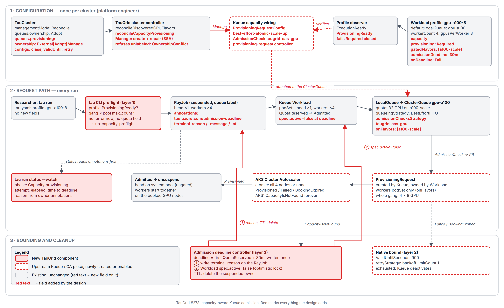
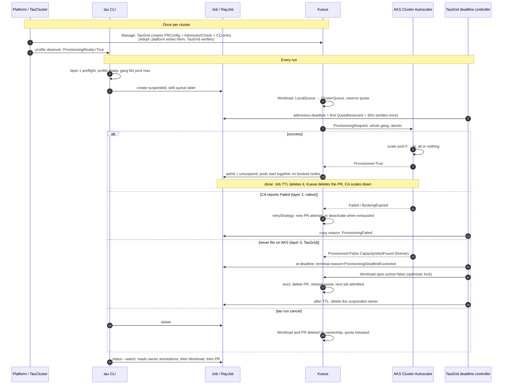
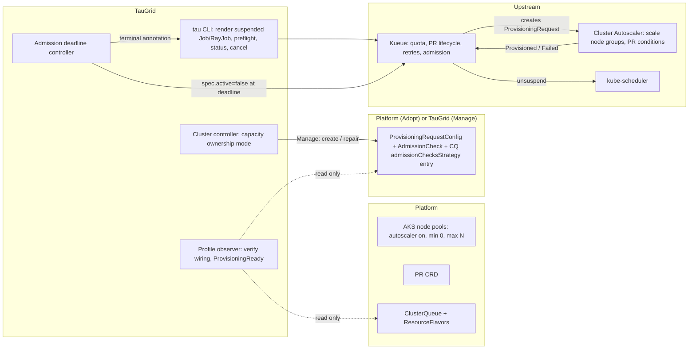
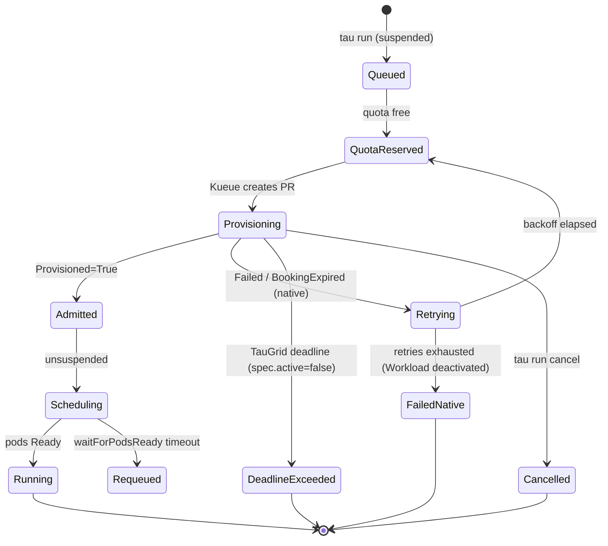
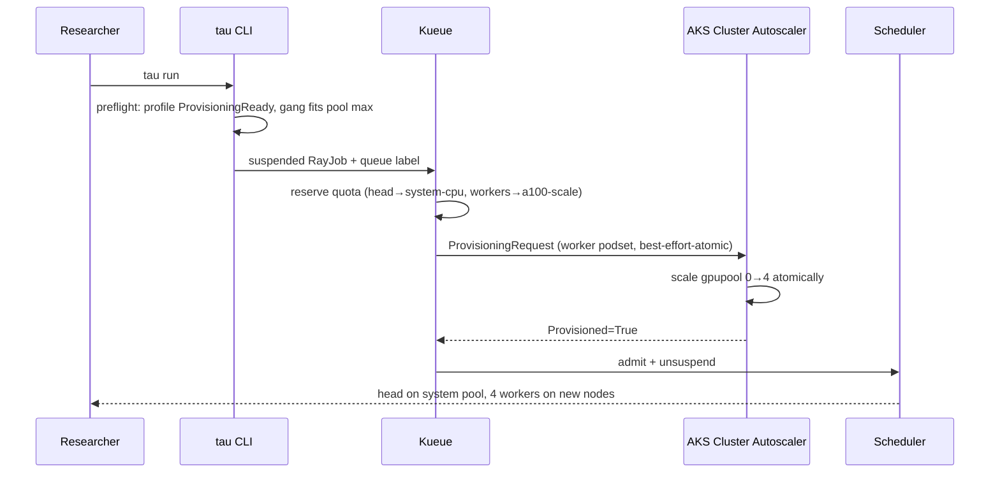
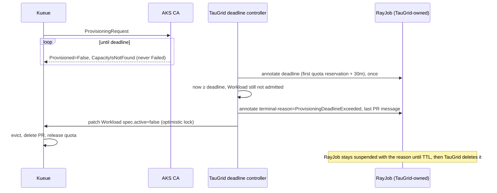

# Capacity-aware Kueue admission with Cluster Autoscaler — design proposal

Issue: [Azure/taugrid#278](https://github.com/Azure/taugrid/issues/278)

## TL;DR

Today Kueue admits a job as soon as **quota** is free. Quota is just a number. If the nodes don't exist yet, the job is unsuspended and its pods sit Pending while Cluster Autoscaler (CA) scales up. If CA can never get the capacity (pool at max size, cloud quota, SKU stock-out), the job holds quota forever and blocks everyone behind it. A multi-node RayJob can end up half-placed.

The design:

1. **Gate admission on capacity using what upstream already built.** Kueue's ProvisioningRequest AdmissionCheck asks CA for the whole gang *before* unsuspending the job, with the `best-effort-atomic-scale-up` class (all nodes or none). TauGrid creates no nodes and no ProvisioningRequests.
2. **Bound every wait in three layers:**
   - TauGrid rejects impossible requests at submit time;
   - CA's `ValidUntilSeconds` plus Kueue's `retryStrategy` handle normal failures;
   - a small TauGrid **admission deadline** controller is the backstop for the AKS case where CA never fails a request.
3. **Release without destroying.** At the deadline TauGrid sets `Workload.spec.active=false`. Kueue evicts, deletes the ProvisioningRequest, and frees quota. TauGrid writes the reason on the Job/RayJob it already owns, so `tau run status` can always explain what happened, even to a watch started later.
4. **Policy lives on the workload profile.** The platform declares "this profile requires capacity gating, deadline 30m." The existing profile observer verifies the Kueue wiring and fails closed if it's wrong.
5. **An explicit control plane on TauCluster with three ownership modes**, the same External/Adopt/Manage enum that `spec.queues.ownership` already uses:
   - **External:** TauGrid ignores capacity wiring, which is today's behavior.
   - **Adopt:** the platform hand-writes the Kueue objects, and TauGrid verifies them and records their UIDs.
   - **Manage:** TauGrid's cluster controller creates the ProvisioningRequestConfig and AdmissionCheck from TauCluster settings and attaches the check to each gated profile's ClusterQueue.

   With Manage, nobody hand-coordinates Kueue objects, which is the issue's main requirement.
6. **Researchers change nothing.** Same `tau run`, `status --watch`, and `cancel`, plus a new **Capacity provisioning** phase. TauWorkspace gets no new field.
7. **Topology is a label, not a second scheduler.** The profile says the level the gang must share (`rack`, `zone`). That label rides the Workload into the ProvisioningRequest. CA keeps an in-memory map from level to domain to nodes, picks one domain that can hold the whole gang, and learns domains it cannot see up front. TauGrid never picks a rack and never stores the map.

## Overall picture

Three planes: who wires Kueue (once per cluster), what happens on every run, and how every wait is bounded.



Red boxes are new TauGrid components, dashed red boxes are upstream Kueue or Cluster Autoscaler pieces this design creates or enables, and red text is a new field on an existing object.

```text
CONFIGURATION PLANE: once per cluster (platform engineer)
┌────────────────────────────┐              ┌────────────────────────────────┐
│ TauCluster                 │              │ Workload profile               │
│ queues.provisioning        │              │ capacity.provisioning: Required│
│   .ownership:              │              │ gatedFlavors: [a100-scale]     │
│ External | Adopt | Manage  │              │ admissionDeadline: 30m         │
└─────────────┬──────────────┘              └───────────────┬────────────────┘
              │ Manage: cluster controller                  │ profile observer verifies
              │ creates + repairs (labeled, SSA)            │ ProvisioningReady (fail closed)
              │ Adopt: platform writes, TauGrid verifies    │
              ▼                                             ▼
┌──────────────────────────────────────────────────────────────────────────────┐
│ Kueue capacity wiring: ProvisioningRequestConfig (atomic class,              │
│ ValidUntilSeconds, retryStrategy) + AdmissionCheck + ClusterQueue check      │
│ entry (onFlavors). Platform also owns node pools (min 0 / max N), the PR     │
│ CRD, ClusterQueue quota and flavors.                                         │
└──────────────────────────────────────────────────────────────────────────────┘

REQUEST PATH: every run (researcher changes nothing but the profile name)
 tau run ──▶ ① preflight ──▶ Job/RayJob ──▶ Workload ──▶ LocalQueue ──▶ ClusterQueue
             profile ready?   suspended     podSets      workspace ns   reserve quota
             gang ≤ max?                                                     │
             no: error now                                                   │ AdmissionCheck
                                                                             ▼
 pods Running ◀── unsuspend ◀── Admitted ◀── Provisioned=True ◀── CA ◀── ProvisioningRequest
 on booked nodes                                          scales 0→N      Kueue creates it,
 (waitForPodsReady after this)                            all or nothing  whole gang

BOUNDING: while quota is held and capacity isn't there
 ② native   PR Failed / BookingExpired ──▶ Kueue retryStrategy ──▶ exhausted: Workload deactivated
 ③ TauGrid  deadline controller
            at first QuotaReserved: owner gets admission-deadline = t + 30m (written once)
            at deadline, still not admitted:
              1. write terminal-reason / message / at on the owner
              2. Workload spec.active=false (optimistic lock: admission that lands first wins)
            Kueue: evict ──▶ delete PR ──▶ release quota ──▶ next job admitted
            after TTL: delete the suspended owner; CA scales empty nodes down

STATUS: tau run status --watch reads owner annotations, then Workload, then PR
 ✓ Submitted   ✓ Quota reserved   … Capacity provisioning   · Pod scheduling   · Running
```

End to end, with the four outcomes the issue asks for:



---

## 1. Problem in TauGrid terms

| Today (quota-only) | Consequence |
|---|---|
| Kueue admits on quota alone; the Job/RayJob is unsuspended immediately | Pods are Pending ~75s+ for a CPU node, longer for GPUs, and the user sees "Running" or "Pending" with no reason |
| CA reacts to Pending pods one at a time | A RayJob can get its head and some workers, then hold them while waiting for the rest |
| A request that can never fit (exceeds pool `max_count`) | Pods stay Pending forever; quota is held; the queue behind it starves |
| `tau run status` can't tell queue wait from scale-up from never | Users cancel and resubmit blindly |

Measured on AKS (huyba's run, one CPU Job, pool scaled from zero): ProvisioningRequest created at 1s, node created at 44s, `Provisioned=True` at 85s, container started at 88s. With quota-only admission, the pod existed with no node for about 75s.

## 2. Constraints

| Constraint | Source | Effect |
|---|---|---|
| TauGrid doesn't provision clusters or nodes | `ROADMAP.md` → Not planned | Use CA through Kueue. No VMSS calls. |
| Scheduling and quota decisions belong to Kubernetes and Kueue | `ROADMAP.md` | TauGrid never fabricates check or PR conditions |
| Kueue v0.19.2, API v1beta2, installed by TauGrid's chart | `charts/taugrid/values.yaml` (`kueue.controllerManager.manager.image.tag`) | `Rejected` is transient in this version (maintainer comment). `waitForPodsReady` can be set in the chart's `managerConfig` |
| TauGrid already writes Kueue objects, but only when told to | `cluster_controller.go` (`mode == ClusterManagementModeReconcile`), `cluster_flavors.go` (adds GPU flavors and quota to ClusterQueues, records `Ownership: Manage`) | Manage mode for capacity objects reuses this gate and this status shape; no new kind of power |
| Ownership enum External/Adopt/Manage | `api/v1alpha1/types.go` (`TauClusterQueuesSpec.Ownership`) | Reuse the same words and semantics |
| Ray head must run on the AKS system pool | `rayjobrender/render.go`, `topology.SystemNodeAffinity()` | Head and workers need different flavors |
| MultiKueue and provisioning checks can't share a ClusterQueue | Kueue + existing observer | v1 is single-cluster only |
| No in-cluster durable run record; Kusto history is optional | `core/runs` | The terminal result must live on an object TauGrid already has |

## 3. Who owns what



| Component | Owns | Never does |
|---|---|---|
| Platform | Node pools, PR CRD, ClusterQueues and flavors. In Adopt mode, also the PRConfig, AdmissionCheck, and the CQ check entry | — |
| TauGrid cluster controller (Manage mode only) | PRConfig + AdmissionCheck it created (labeled `app.kubernetes.io/managed-by=taugrid`), and only its own `admissionChecksStrategy` entry on the profile's ClusterQueue | Take over unlabeled objects; touch other CQ fields; create PRs |
| Kueue | Quota, PR creation and deletion, native retries, admission | — |
| Cluster Autoscaler | Node scale-up and scale-down, PR conditions | — |
| TauGrid CLI | Suspended manifests, preflight, phases, cancel | Create PRs, scale nodes |
| TauGrid observer | Validate wiring per profile, publish readiness | Write Kueue or CA objects |
| TauGrid deadline controller | Enforce profile deadline; write terminal reason on TauGrid-owned objects | Patch PR or AdmissionCheck status; delete nodes |

TauGrid's Kueue writes are limited to two cases. The cluster controller, in Manage mode only, writes the capacity configuration objects it owns (§4.3). The deadline controller writes exactly one field on a runtime Kueue object: `Workload.spec.active`. That is Kueue's documented, user-facing deactivation switch. It is the same switch Kueue's own `waitForPodsReady` requeue limit uses.

---

## 4. User experience

### 4.1 Researcher: nothing new to configure

```bash
tau run --config tau.yaml           # profile gpu-a100-8 is capacity-gated
tau run status train --watch
```

```text
Startup phases:
  ✓ Submitted               RayJob applied (suspended)
  ✓ Quota reserved          32 nvidia.com/gpu on ClusterQueue gpu-a100
  … Capacity provisioning   CA scaling gpupool 0→4 (attempt 1, 3m12s / deadline 30m)
  · Pod scheduling
  · Running
```

Failure, including for a watch started after the fact:

```text
  ✗ Capacity provisioning   ProvisioningDeadlineExceeded after 30m: CapacityIsNotFound
                             (gpupool max 2 nodes, request needs 4). Quota released.
  hint: request fewer workers, or ask the platform team to raise gpupool max_count.
```

Fail-fast at submit:

```text
$ tau run --config tau.yaml
error: profile gpu-a100-8 requests 4 nodes of Standard_ND96asr_v4; node pool gpupool max_count is 2.
       This request can never be provisioned. Use --skip-capacity-preflight to submit anyway.
```

### 4.2 Platform engineer: profile policy

```yaml
# TauCluster
spec:
  workloadProfiles:
    - name: gpu-a100-8
      defaultLocalQueue: gpu-a100
      gpusPerWorker: 8
      workerCount: 4
      mode: fixed
      placement: same-network-domain   # topology level the workers must share; see §10
      capacity:
        provisioning: Required          # Required | Optional | Disabled (default)
        config: cas-gpu                 # entry in spec.queues.provisioning.configs
        gatedFlavors: [a100-scale]      # becomes onFlavors; the Ray head's system-cpu stays ungated
        admissionDeadline: 30m          # TauGrid backstop, from first quota reservation
        onDeadline: Fail                # Fail | Requeue (bounded, v2)
```

- **`Required`:** the observer fails the profile closed (`ExecutionReady=False`) unless its ClusterQueue has an active `kueue.x-k8s.io/provisioning-request` check covering every `gatedFlavors` entry.
- **`Optional`:** report only. **`Disabled`** (the default): today's quota-only behavior.

The profile says **what** the policy is. The ownership mode below says **who writes the Kueue objects** that implement it.

### 4.3 TauCluster: the capacity control plane and its three modes

```yaml
# TauCluster
spec:
  managementMode: Reconcile               # existing: Observe | Reconcile
  queues:
    ownership: Adopt                      # existing: who owns ClusterQueues and flavors
    clusterQueues: [{name: gpu-a100}]
    provisioning:                         # new
      ownership: Manage                   # External (default) | Adopt | Manage
      configs:
        - name: cas-gpu
          # Manage: TauGrid creates PRConfig + AdmissionCheck "taugrid-cas-gpu" from these fields
          className: best-effort-atomic-scale-up.autoscaling.x-k8s.io
          managedResources: [nvidia.com/gpu]
          validUntilSeconds: 900
          retry: { backoffLimitCount: 1, backoffBaseSeconds: 60, backoffMaxSeconds: 600 }
          # Adopt instead: point at the platform's existing AdmissionCheck
          # admissionCheckName: platform-cas-gpu
```

| | External (default) | Adopt | Manage |
|---|---|---|---|
| Who writes the PRConfig and AdmissionCheck | Platform, or nobody | Platform | **TauGrid cluster controller** |
| Who attaches the check to the ClusterQueue (`admissionChecksStrategy` + `onFlavors`) | Platform | Platform | **TauGrid**, only its own entry, on the CQ each gated profile resolves to |
| TauGrid verifies the wiring (`ProvisioningReady`) | No | Yes | Yes |
| Recorded in `status.managedResources` | No | Yes, `Ownership: Adopt` + UID | Yes, `Ownership: Manage` + UID |
| Allowed profile `capacity.provisioning` | `Disabled` only (CEL validation) | Any | Any |
| Drift (someone edits the objects) | Not looked at | Reported: `ProvisioningReady=False`, `DriftDetected` | Repaired under `managementMode: Reconcile`; reported only under `Observe` |
| Existing object with the same name, not labeled `managed-by=taugrid` | — | Expected; that's what Adopt means | **Not taken over**: `ProvisioningReady=False reason=OwnershipConflict`, hint "use Adopt" |
| TauCluster deleted | Nothing | Nothing (TauGrid never owned them) | `deletionPolicy: Retain` leaves them; `DeleteManaged` removes the objects and TauGrid's CQ entry |
| Who it's for | Clusters that don't use the feature | Platform teams with GitOps-owned Kueue config | Platform teams that want to declare intent and let TauGrid do the wiring |

Manage mode only writes under `managementMode: Reconcile`, the same gate `cluster_flavors.go` already uses to add GPU flavors and quota to ClusterQueues. It writes the ClusterQueue entry with server-side apply (field manager `taugrid-capacity`), so when `queues.ownership` is External or Adopt, the platform still owns every other field of its ClusterQueue.

**Decisions:**

- **TauWorkspace gets no new field.** A workspace's LocalQueue points at a ClusterQueue, and gating is a property of that ClusterQueue and its profile. A workspace can't opt out of gating on a shared queue, because that would let it hold quota without capacity, which is the bug.
- **Researchers never see the mode.** `tau.yaml` picks a profile, and the profile carries the policy.
- **Kueue objects are created by the controller, not by Helm.** A Helm template can't tell which ClusterQueue a profile resolves to, can't detect conflicts, and can't report drift. The chart only sets `waitForPodsReady` in Kueue's `managerConfig` (§8).

In Adopt mode, the platform writes the objects itself. This is what Manage mode generates for the config above:

```yaml
apiVersion: kueue.x-k8s.io/v1beta2
kind: ProvisioningRequestConfig
metadata: { name: taugrid-cas-gpu }
spec:
  provisioningClassName: best-effort-atomic-scale-up.autoscaling.x-k8s.io
  managedResources: [nvidia.com/gpu]
  parameters:
    ValidUntilSeconds: "900"           # CA should retry for 15m, then mark Failed
  retryStrategy:
    backoffLimitCount: 1
    backoffBaseSeconds: 60
    backoffMaxSeconds: 600
---
apiVersion: kueue.x-k8s.io/v1beta2
kind: AdmissionCheck
metadata: { name: taugrid-cas-gpu }
spec:
  controllerName: kueue.x-k8s.io/provisioning-request
  parameters: { apiGroup: kueue.x-k8s.io, kind: ProvisioningRequestConfig, name: taugrid-cas-gpu }
---
apiVersion: kueue.x-k8s.io/v1beta2
kind: ClusterQueue
metadata: { name: gpu-a100 }           # platform-owned (queues.ownership: Adopt)
spec:
  queueingStrategy: BestEffortFIFO     # platform sets this; one stuck gang must not block smaller jobs
  admissionChecksStrategy:             # the only part Manage mode writes, via SSA
    admissionChecks:
      - name: taugrid-cas-gpu
        onFlavors: [a100-scale]        # from profile capacity.gatedFlavors
  resourceGroups:                      # platform-owned
    - coveredResources: [cpu, memory]
      flavors:
        - name: system-cpu             # Ray head: AKS system pool, never gated
          resources: [{name: cpu, nominalQuota: "8"}, {name: memory, nominalQuota: 32Gi}]
        - name: a100-scale
          resources: [{name: cpu, nominalQuota: "384"}, {name: memory, nominalQuota: 3Ti}]
    - coveredResources: [nvidia.com/gpu]
      flavors:
        - name: a100-scale
          resources: [{name: nvidia.com/gpu, nominalQuota: "32"}]
```

Runbook prerequisites (all modes):

- Install the `ProvisioningRequest` CRD **before** Kueue starts. AKS didn't ship it in huyba's 1.35 run, and Kueue silently disables the feature without it. The observer reports `ProvisioningCRDMissing`. Because the TauGrid chart installs Kueue, `tau cluster install` can apply the CRD first when `queues.provisioning.ownership` isn't External.
- Autoscaled pool with `min_count=0` and a realistic `max_count`.
- An aggressive scale-down profile, so nodes from failed or abandoned attempts go away quickly.

### 4.4 How the control plane reconciles (Manage)

```go
func (r *TauClusterReconciler) reconcileCapacityProvisioning(ctx context.Context, c *TauCluster, mutate bool) ([]TauManagedResourceStatus, error) {
    p := c.Spec.Queues.Provisioning
    if p == nil || p.Ownership == External {
        return nil, nil
    }
    var managed []TauManagedResourceStatus
    for _, cfg := range p.Configs {
        if p.Ownership == Adopt {
            ac, err := r.verifyAdmissionCheck(ctx, cfg.AdmissionCheckName)   // exists, provisioning controller, Active=True
            if err != nil { return managed, err }                             // surfaces as ProvisioningReady=False
            managed = append(managed, managedResourceStatus(admissionCheckGVK, ac, Adopt))
            continue
        }
        prc, err := r.ensureOwned(ctx, renderPRConfig(cfg), mutate)          // refuses unlabeled → OwnershipConflict
        if err != nil { return managed, err }
        ac, err := r.ensureOwned(ctx, renderAdmissionCheck(cfg), mutate)
        if err != nil { return managed, err }
        managed = append(managed, managedResourceStatus(prcGVK, prc, Manage), managedResourceStatus(admissionCheckGVK, ac, Manage))
    }
    if p.Ownership == Manage {
        for cq, entries := range gatedEntriesByClusterQueue(c.Spec.WorkloadProfiles) {
            if err := r.applyCheckEntries(ctx, cq, entries, mutate); err != nil { // SSA, field manager taugrid-capacity
                return managed, err
            }
        }
    }
    return managed, nil
}
```

It follows the existing `reconcileDiscoveredGPUFlavors(ctx, mutate)` pattern: `mutate` is `managementMode == Reconcile`. Under `Observe`, the same code computes drift and reports it without writing.

### 4.5 Mapping to the issue's requirement

"Users should not need to manually coordinate Kueue objects, autoscaler-specific APIs, placeholder workloads, retries, or cleanup":

| Item | Who handles it |
|---|---|
| Kueue objects | Manage mode generates them from TauCluster. Researchers never see them; platform engineers declare intent. |
| Autoscaler-specific APIs | Kueue creates the ProvisioningRequest; TauGrid never does. |
| Placeholder workloads | None; the atomic provisioning class replaces them. |
| Retries | Kueue `retryStrategy` (layer 2) plus the TauGrid deadline (layer 3). |
| Cleanup | Kueue deletes the PR when the Workload is deactivated or deleted; CA scales unused nodes down; TauGrid deletes timed-out owners after TTL (§6). |

---

## 5. Lifecycle and sequences

### 5.1 States



### 5.2 Success



### 5.3 Stuck capacity, bounded by TauGrid



---

## 6. Admission deadline controller

A small reconciler in `tau-core-controller`, off unless a profile sets `capacity.provisioning != Disabled`.

**Scope (to avoid cluster-wide blast radius):** only Workloads whose owner is a TauGrid-labeled Job/RayJob, in a workspace namespace, on a ClusterQueue that a capacity-gated profile resolves to.

**State is stored on the TauGrid-owned owner object**, not in a new CRD:

| Annotation on Job/RayJob | Written | Meaning |
|---|---|---|
| `tau.azure.com/admission-deadline` | once, at first `QuotaReserved=True` | Absolute RFC3339 time. Never recomputed, so retries, check resets, and restarts can't extend it. |
| `tau.azure.com/terminal-reason` | at deadline, or when Kueue's native retries are exhausted | `ProvisioningDeadlineExceeded`, `ProvisioningFailed` (copied from the Workload condition so it survives Kueue's check reset) |
| `tau.azure.com/terminal-message` | same | Last PR reason and message, attempts, pool hint |
| `tau.azure.com/terminal-at` | same | Used for TTL cleanup |

Why this works without a new store:

- The owner object survives, because deactivation doesn't delete it. A suspended Job/RayJob with a deactivated Workload uses no quota and creates no pods.
- `tau run status` already reads Job/RayJob objects, so it reads the annotations first. A watch started an hour later still sees the reason.
- Cancel needs no annotation. `tau run cancel` already deletes the Job/RayJob (`run_lifecycle.go`) and waits for compute release. Kueue deletes the Workload, and the PR goes with it.
- **Cleanup has to be TauGrid's job.** The Kubernetes TTL controller only deletes *finished* Jobs, and a suspended Job with a deactivated Workload isn't finished. The RayJob's 15s TTL (`rayjobrender/render.go`) only applies after the Ray job ends. So at `terminal-at` + the workspace's `ttlSecondsAfterFinished` (`WorkspaceDefaults`, minimum 600s), the controller deletes the owner. Kueue then deletes the Workload. Kusto history keeps the record where configured.

**Reconcile:**

```go
func (r *AdmissionDeadlineReconciler) Reconcile(ctx context.Context, req ctrl.Request) (ctrl.Result, error) {
    wl, owner, policy, ok := r.load(ctx, req)              // TauGrid-owned + capacity-gated profile only
    if !ok || admitted(wl) || finished(wl) || !active(wl) {
        return r.maybeTTLCleanup(ctx, owner)
    }
    if terminal(owner) {                                    // timeout already decided: finish the job
        return ctrl.Result{}, r.deactivate(ctx, wl)
    }
    if !quotaReserved(wl) {
        return ctrl.Result{}, nil                           // queue wait: not this controller's clock
    }
    deadline, err := r.ensureDeadline(ctx, owner, firstReservation(wl)+policy.AdmissionDeadline)
    if err != nil { return ctrl.Result{}, err }
    if now := r.clock.Now(); now.Before(deadline) {
        return ctrl.Result{RequeueAfter: deadline.Sub(now)}, nil
    }
    if err := r.markTerminal(ctx, owner, "ProvisioningDeadlineExceeded", lastPRMessage(ctx, wl)); err != nil {
        return ctrl.Result{}, err                           // conflict → requeue and re-evaluate
    }
    return ctrl.Result{}, r.deactivate(ctx, wl)             // MergeFromWithOptimisticLock
}
```

**Correctness rules:**

1. **Terminal intent first, then deactivate.** If the process crashes in between, the next reconcile sees `terminal(owner)` and finishes the deactivation.
2. **Optimistic lock on both patches.** If Kueue admits the Workload between the read and the write, the patch fails with a conflict. The re-read sees `Admitted`, and success wins over a deadline that wasn't committed yet. (huyba's prototype misses this.)
3. **Once terminal intent is committed, it wins.** A late `Provisioned=True` can't resurrect a timed-out run, because the Workload is inactive, so Kueue won't admit it. A cancelled run has no Workload at all.
4. **The deadline is absolute and stored**, so restarts and native retries don't extend it.
5. **It never writes PR or AdmissionCheck status, and never deletes nodes.** CA scales down unused nodes on its own.

**`onDeadline: Requeue` (v2):** re-activate after a backoff with a new deadline, up to N attempts. It's useful for spot or stock-out conditions that clear by themselves. `Fail` is the v1 default because it gives a clear signal.

## 7. Three layers of bounding

| Layer | Catches | Cost when it fires | Owner |
|---|---|---|---|
| 1. Submit preflight | Gang can't fit pool `max_count` × node allocatable; profile not `ProvisioningReady`; PR CRD missing | Instant error, no quota held | TauGrid CLI (reads `cluster-autoscaler-status` ConfigMap + node pool labels; warns if unreadable) |
| 2. Native: `ValidUntilSeconds` + `retryStrategy` | Transient cloud errors and stock-outs, where CA honors the parameter | Bounded retries; Kueue deactivates the Workload when they're exhausted | CA + Kueue |
| 3. TauGrid admission deadline | Anything that never resolves, including AKS `CapacityIsNotFound`, which stayed unresolved for 21 min even with `ValidUntilSeconds=600` in huyba's run | Quota held until the deadline, then released | TauGrid controller |

**Deadline sizing:** p99 scale-up time for the SKU × 2, plus image pull. Roughly 10–15m for CPU and 30–45m for big GPU SKUs. Shorter deadlines release blocked quota sooner but risk killing slow-but-successful scale-ups. Tune with the metric `tau_capacity_provisioning_seconds` (histogram per profile).

**Quota is held during scale-up.** That's inherent to Kueue's design: reserve first, then provision. It's why gated ClusterQueues should use `BestEffortFIFO` (a stuck big gang doesn't block smaller jobs that fit) and why the deadline matters.

## 8. After admission: `waitForPodsReady`

`Provisioned=True` isn't "Running." A GPU node can be `Ready` before the device plugin advertises `nvidia.com/gpu`, an image pull can fail, and a booking can be lost. Enable Kueue `waitForPodsReady` in the TauGrid chart's `kueue.managerConfig` (it isn't set today). It's a Kueue-wide setting, not per queue:

```yaml
waitForPodsReady:
  enable: true
  timeout: 10m
  recoveryTimeout: 3m
  requeuingStrategy: { timestamp: Eviction, backoffLimitCount: 2 }
```

This is complementary to the pre-admission deadline. TauGrid's phases separate them: "Capacity provisioning" (before admission) and "Pod scheduling" (after admission).

## 9. Ray: head and workers

TauGrid renders the head with AKS system-pool affinity and the workers with the profile selector.

- Head CPU/memory must be assigned to `system-cpu`, which isn't gated.
- Workers must be assigned to `a100-scale`, which is gated, so only the workers go into the PR.

Gate before claiming Ray support: submit an unchanged TauGrid-rendered RayJob on Kueue **v0.19.2** and assert:

- `Workload.status.admission.podSetAssignments`: head → `system-cpu`, workers → `a100-scale`;
- the PR references only the worker pod template, and the head template has no `agentpool` selector injected;
- `podSetMergePolicy` doesn't merge head and workers;
- the head schedules on a system node, and workers on new gpupool nodes.

If Kueue can't assign them this way from the existing constraints, make the smallest renderer change: give the head its own resource group or flavor ordering. Don't silently drop head affinity.

Ray's own in-cluster autoscaler must stay off for gated RayJobs. Kueue admits a fixed gang.

## 10. Topology

Atomic scale-up answers "give me N nodes." It does not answer "give me N nodes in the same rack." A training gang that lands across racks pays for cross-rack traffic, and Kueue's topology-aware scheduling cannot choose a rack while the pool is still at zero nodes. The rack has to be chosen by the component that creates the nodes.

Three steps:

1. **The profile puts a label on the job.** `placement: same-network-domain` names a level, not a specific rack. `tau` writes it on the worker pod template, which is the part Kueue already copies onto the Workload and into the ProvisioningRequest. The head is not labeled, so it stays on the system pool.

```text
kueue.x-k8s.io/podset-required-topology: rack
```

Kueue stores that on the Workload pod set and embeds the same template in the ProvisioningRequest. TauGrid does not fork Kueue, and it does not add a side channel. The label is the whole contract. CA reads it from the ProvisioningRequest.

2. **Kueue forwards the label and does not pick the domain.** The provisioning controller creates the ProvisioningRequest after quota is reserved, as in §5. The request still means "this many pods, all or nothing," plus "all of them in one domain at the labeled level." Which rack, which zone, or which region is CA's choice. Only CA knows what already exists and what it can still create.

3. **CA keeps an in-memory topology map and assigns from it.** The map is a cache, rebuilt from node labels on startup and updated when a node is added or removed. Node labels are the source of truth. CA never writes the Workload.

```text
level   domain          nodes                          free
rack    rack-17         aks-gpupool-vmss042, ...043    8 GPU
rack    rack-18         aks-gpupool-vmss110            16 GPU
zone    westus2-1       (everything above in that zone)
```

For a request of K nodes at level L, CA picks one domain where the nodes it already has, plus the nodes it can still add in that domain, fit K. It scales only inside that domain, labels the new nodes with the domain it chose, and sets `Provisioned=True` only when all K are in it. If one domain is short, it tries the next domain in the map. If none fit, the answer is `Provisioned=False` / `CapacityIsNotFound`, and the deadline in §6 releases the quota. The gang is never split across domains.

Where the map comes from depends on who owns the machines:

| Source | What CA knows up front | How the map is filled |
|---|---|---|
| Local machines (bare metal, KWOK, a pool whose nodes already carry the labels) | The full map. The inventory or the placement group is the domain. | Read node labels. Assignment is possible before the scale-up. |
| Third-party cloud | Region and zone, usually. Rack, often not, until a VM exists. | Start with the levels the cloud API returns. After each scale-up, read the labels the cloud controller writes on the new node and append that node to the domain. A level that has never been observed has no entry. |

An unknown level is not guessed. If the provider can create a placement group, CA creates the gang through that one call, records the domain the provider returns, and reuses it for the next job. If the provider has no such API, CA reports `Provisioned=False` with reason `TopologyUnknown` and does not create a scattered gang. The in-flight job pays the deadline once. The observer sees that no node and no placement group exposes the label, and fails the profile closed with `TopologyLevelMissing`, so the next submit is rejected at preflight. TauGrid still does not store the map and does not choose the rack.

## 11. CLI and status changes

| File / surface | Change |
|---|---|
| `core/status/phases.go` | Today `kueuePhase` is a single "Kueue admission" phase (admitted/pending count + reason). Split it: **Quota reserved**, then **Capacity provisioning** for Workloads with a check whose controller is exactly `kueue.x-k8s.io/provisioning-request`, then pod scheduling. |
| `WatchFailed` / `StartupFailed` | Today an admission-check `Rejected` only counts as failure in the MultiKueue manager view (`AnyAdmissionCheckRejected`). New precedence: (1) `tau.azure.com/terminal-reason` on the owner; (2) Workload `spec.active=false` with Kueue's provisioning-retry-exhausted condition; (3) check and PR state for detail only. **Never terminate only on `Rejected`.** |
| `WatchComplete` | Quota reserved + provisioning pending is never complete |
| `tau run` preflight | Profile `ProvisioningReady`; gang-vs-pool-max fail-fast; `--skip-capacity-preflight` |
| `tau run cancel` | Unchanged: it deletes the Job/RayJob and waits for release. Add "ProvisioningRequest deleted" to what it waits on and reports. |
| `tau cluster validate` / `tau cluster profiles` / `TauCluster.status` | `ProvisioningReady` per profile: CRD present, AdmissionCheck active, config readable, class supported, `onFlavors` covers `gatedFlavors`, no MultiKueue mixing. Show the ownership mode and `managedResources` entries. |
| Observer (`workload_profile_observer.go`, the loop around L393–418) | Today checks are split into `multiKueueChecks` and `otherChecks`. Add a `provisioningChecks` class; fail profiles with `capacity.provisioning: Required` closed |
| Cluster controller (`cluster_controller.go`) | Call `reconcileCapacityProvisioning(ctx, cluster, mode == Reconcile)` next to `reconcileDiscoveredGPUFlavors` (§4.4) |
| `TauClusterQueuesSpec` (`api/v1alpha1/types.go`) | Add `Provisioning *TauClusterProvisioningSpec{Ownership, Configs}`; CEL: External ⇒ no profile with `capacity.provisioning != Disabled` |

---

## 12. Failure modes

| Scenario | Signal | Behavior |
|---|---|---|
| Scale-from-zero succeeds | PR `Provisioned=True` | Admit → schedule → run; phase durations recorded |
| Gang larger than pool max | Preflight detects | Rejected at submit; no quota held |
| Pool max OK, but cloud quota or SKU stock-out | `CapacityIsNotFound` or `Failed` | Native retries if `Failed`; otherwise TauGrid deadline → `ProvisioningDeadlineExceeded`, quota released |
| CA never processes the PR (CA down, CRD missing) | PR without conditions / no PR | Observer `ProvisioningReady=False` blocks new submits; deadline releases in-flight jobs |
| Partial capacity for a RayJob | Atomic class keeps `Provisioned=False` | No half-placed Ray cluster; same deadline path |
| Transient `Rejected` with check reset | Workload deactivated, check `Pending` | Watch uses the owner annotation or Workload condition; never hangs |
| Deadline races with `Provisioned=True` | Patch conflict | Re-read; if admitted, success wins; otherwise the deadline wins |
| Cancel during scale-up | `tau run cancel` deletes the Job/RayJob | Kueue deletes the Workload and the PR; quota released; CA scales extra nodes down later |
| Controller restart mid-wait | Stored absolute deadline | Same deadline; idempotent |
| Provisioned, but GPU not allocatable / image pull fails | Pods Pending after admission | `waitForPodsReady` requeue, shown as Pod scheduling |
| Booking expires before pods land | PR `BookingExpired` | Kueue native retry; deadline unchanged |
| MultiKueue + provisioning on one ClusterQueue | Observer | Profile fails closed (existing disjointness rule) |
| Manage mode finds an unlabeled AdmissionCheck/PRConfig with its name | Cluster controller | Not taken over; `ProvisioningReady=False reason=OwnershipConflict`; hint: switch to Adopt or rename |
| Someone edits a TauGrid-managed AdmissionCheck or removes the CQ entry | Cluster controller drift check | Repaired under `Reconcile`; `DriftDetected` under `Observe` |
| Adopted AdmissionCheck deleted by the platform | Observer | `ProvisioningReady=False`; `Required` profiles block new submits; in-flight jobs still bounded by the deadline |
| Timed-out run never cleaned up (Job TTL doesn't apply to suspended Jobs) | `terminal-at` + workspace TTL | Deadline controller deletes the owner; Kueue deletes the Workload |
| Feature disabled (default) | — | Quota-only behavior exactly as today |
| Gang must share a rack, and one domain is short | CA map has another domain that fits | CA assigns that domain; still one ProvisioningRequest, still all or nothing |
| No domain at the requested level can hold the gang | `CapacityIsNotFound` | Same deadline path as pool-at-max; quota released; gang is not split |
| Cloud has never exposed the requested level | PR `Provisioned=False`, reason `TopologyUnknown` | No nodes created. Deadline fires once. Later submits fail preflight while the map has no domain at that level |
| CA restarts mid-assignment | Map rebuilt from node labels before the next pass | Same domain if the nodes are still labeled; no second source of truth |

## 13. Alternatives considered

| Option | Why not |
|---|---|
| Quota-only + pending-pod autoscaling (today) | Quota held with no capacity; partial gangs; no signal |
| Placeholder or balloon pods to pre-scale | Manual, racy, steals nodes, needs cleanup logic: exactly what the issue wants to avoid |
| TauGrid calls AKS or VMSS directly | Duplicates CA; violates "no cluster provisioning" |
| `check-capacity` class | Only checks existing nodes; can't scale from zero |
| Rely on Kueue `retryStrategy` alone | AKS `CapacityIsNotFound` never becomes `Failed`, so retries never advance |
| Rely on `ValidUntilSeconds` alone | Not honored for the pool-at-max case on AKS in practice; keep it as layer 2 |
| CLI-side timeout | Doesn't work when the laptop is closed; can't release quota reliably |
| Delete the owner at the deadline | Loses the record the CLI reads and forces a new durable store |
| Patch PR `Failed` or AdmissionCheck `Rejected` | Writes into another controller's status; races; unsound ownership |
| Karpenter / node auto-provisioning | Future provider; different class semantics; not AKS-managed CA |
| Let Kueue TAS pick the rack before scale-up | TAS slices existing nodes. At min 0 there is nothing to slice. The label still uses Kueue's topology annotation so the scheduler stays inside the domain CA booked. |
| TauGrid keeps the topology map or picks the rack | TauGrid does not inventory nodes and does not call the cloud. The map has to live in CA, next to the scale-up decision. |

## 14. Prototype plan (thin, end to end)

A laptop version of the success path (scenario 1 / §5.2) runs today in [`examples/capacity-provisioning-demo/`](examples/capacity-provisioning-demo/README.md):
real Kueue v0.19.2 on kind, with a simulated autoscaler and KWOK nodes.

**Environments:**

1. **CI:** a stub PR controller that can set `Provisioned=True`, `Failed=True`, repeat `Provisioned=False/CapacityIsNotFound`, or stay silent. Kind runs Kueue **v0.19.2** + KubeRay.
2. **AKS CPU lab:** a system pool for controllers and the Ray head, plus a user pool `cpupool` with `min=0, max=2`. CRD installed before Kueue.

**Scenarios (both a Job and a RayJob rendered by `tau`):**

| # | Scenario | Pass criteria |
|---|---|---|
| 1 | Job, 2 pods needing 2 nodes, pool at 0 | No pod before `Provisioned=True`; Job completes; phase timings printed |
| 2 | RayJob, head + 2 workers | Head on system node; `podSetAssignments` as in §9; RayJob succeeds |
| 3 | Job needing 3 nodes (> max 2) | Preflight rejects; with `--skip-capacity-preflight`, `CapacityIsNotFound` → deadline (5m in the lab) → terminal annotation; quota released; a small job submitted next is admitted |
| 4 | Stub `Failed=True` | Kueue native retry → exhaustion → watch fails with the native reason |
| 5 | Silent CA | Deadline still fires |
| 6 | Cancel during scale-up | Owner and Workload deleted, PR deleted, no pods, quota released; `cancel` reports the PR gone; extra nodes scale down later |
| 7 | Restart the controller at 60% of the deadline | Fires at the original deadline, not later |
| 8 | Start `--watch` after timeout and after cleanup TTL | Before TTL: shows the reason from the annotation. After TTL: shows the history entry or "not found," not "Pending." |
| 9 | Admission races the deadline (stub sets `Provisioned` at deadline − 1s) | Job runs; no deactivation |
| 10 | Default install (feature off) | Existing e2e suite is unchanged |
| 11 | **Cleanup after timeout** (scenario 3, lab TTL 600s) | At `terminal-at` + 600s the owner is deleted; Workload and PR are gone; no orphan pods; CA scales any half-made nodes back to 0 within the scale-down window |
| 12 | **Cleanup after success** | Job finishes; native Job TTL deletes it; PR is gone; pool returns to 0 |
| 13 | **Manage mode** on a fresh cluster with `managementMode: Reconcile` | Controller creates PRConfig + AdmissionCheck, adds the CQ entry with `onFlavors`; `status.managedResources` lists them with `Ownership: Manage`; deleting the AdmissionCheck by hand gets it recreated |
| 14 | **Adopt conflict**: pre-create an unlabeled `taugrid-cas-gpu`, then set Manage | No overwrite; `OwnershipConflict`; switching to Adopt with `admissionCheckName` turns `ProvisioningReady=True` |
| 15 | **DeleteManaged**: delete the TauCluster | Managed AdmissionCheck/PRConfig and TauGrid's CQ entry removed; platform's CQ fields untouched |
| 16 | **Topology, local inventory** | Workers labeled `podset-required-topology: rack`; CA map has two racks; both nodes land in one rack; a third node that only fits by splitting racks is `CapacityIsNotFound` |
| 17 | **Topology, cloud learning** | First request at level `rack` on a provider with no rack API returns `TopologyUnknown` and creates no nodes; after a placement-group scale-up, the map has one domain and the next gang reuses it |

## 15. Rollout

| Milestone | Scope |
|---|---|
| M0 | Docs and runbook; `queues.provisioning` API with **External and Adopt only**; observer classifies provisioning checks and reports `ProvisioningReady` (read-only) |
| M1 | CLI Capacity provisioning phase + correct watch precedence; submit preflight |
| M2 | Admission deadline controller (profile policy, owner annotations, optimistic lock, TTL cleanup); CPU lab e2e |
| M2.5 | **Manage mode**: controller creates PRConfig/AdmissionCheck and the CQ entry under `Reconcile`; conflict, drift, and `DeleteManaged` handling; `tau cluster install` applies the PR CRD before Kueue |
| M3 | Ray flavor validation on v0.19.2 (and the minimal renderer change if needed); `waitForPodsReady` for gated queues |
| M4 | GPU lab (scale from zero on a GPU SKU); metrics and deadline tuning; `onDeadline: Requeue` |
| M5 | Topology label on the worker template (§10); CA in-memory map for local nodes; `TopologyUnknown` for a cloud level with no domains yet; preflight once a level is known to be absent |

## 16. Questions for reviewers

1. You mentioned an implementation is already in progress. Which parts of this match it, and where did you choose differently?
2. Is it acceptable for TauGrid to set `Workload.spec.active=false`, or should TauGrid only ever touch its own objects (Job/RayJob suspend or delete)?
3. Have you seen `ValidUntilSeconds` honored by AKS CA in any failure mode? If yes, the TauGrid deadline can default longer.
4. Should a timed-out job stay visible as a suspended object until the TTL, or be deleted immediately and recorded only in history?
5. Is per-profile policy the right home for the deadline, or should it be per-queue in Helm?
6. Is TauGrid writing one `admissionChecksStrategy` entry into a platform-owned ClusterQueue (SSA, its own field manager) acceptable, or should Manage mode require `queues.ownership: Manage` too?
7. For a third-party cloud that has no placement-group API, is `TopologyUnknown` plus a deadline the right answer, or should the gang fall back to a coarser level (zone) instead of failing?
