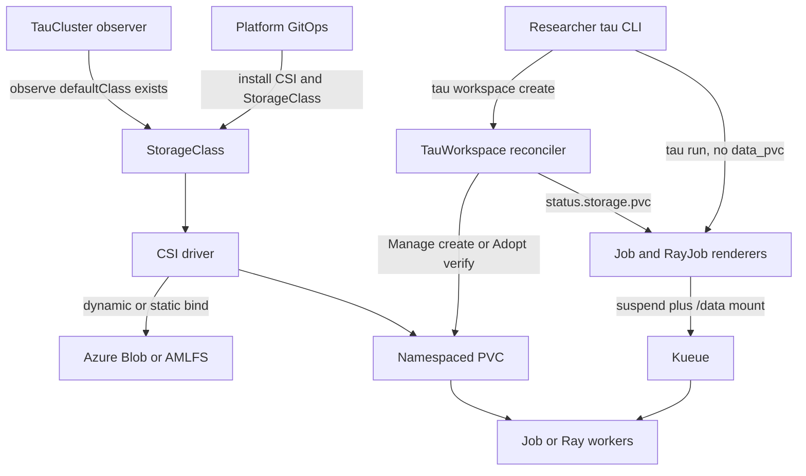
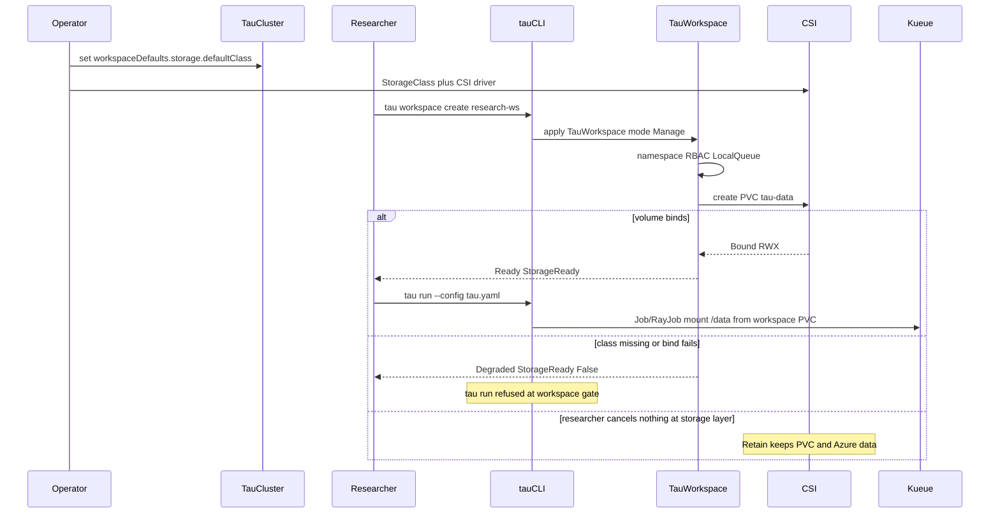

# Managed storage layer for TauGrid

Status: **revised design proposal, awaiting review.** No implementation code is written yet.

GitHub: [#277](https://github.com/Azure/taugrid/issues/277)

Scope: a TauGrid system contract so researchers use durable storage for
datasets, checkpoints, shared working state, and outputs without assembling
StorageClasses, PVCs, CSI drivers, or cloud accounts first. Platform teams
still own those backends. TauGrid owns workspace claim intent, readiness, and
the path/env contract workloads already use.

Primary integration: **AKS** with Azure Blob CSI (BlobFuse2) as the default
backend and Azure Managed Lustre as the high-I/O opt-in. Secondary: any Bound
RWX PersistentVolumeClaim a platform already operates, including Kind for a
thin prototype.

This is a **workflow and lifecycle design**. It is not a TauGrid cloud
provisioner, not a POSIX filesystem, and not cluster provisioning
([ROADMAP.md](../../ROADMAP.md) "Not planned"). It is the post-0.1 storage
lifecycle fast-follow named in
[`cluster-overlays/azure/storage/README.md`](../../cluster-overlays/azure/storage/README.md).

## Proposed design decisions (for review)

| # | Decision | Consequence |
|---|---|---|
| D1 | **`TauWorkspace` owns claim intent.** `spec.storage.mode` is `Manage`, `Adopt`, or `External`. Manage creates a namespaced PVC; Adopt verifies an existing Bound claim; External is today's 0.1 behavior. | The controller never creates StorageClasses, PVs, CSI drivers, Azure storage accounts, AMLFS clusters, or identities. CSI may still create Azure resources as a **StorageClass** side effect. |
| D2 | **Researchers stop naming the default PVC.** A Ready Manage/Adopt workspace supplies the `/data` claim. Explicit `storage.data_pvc` remains an override. | `defaultTauPVCName = "blob-training"` in [`cli/internal/cli/pvc_helpers.go`](../../cli/internal/cli/pvc_helpers.go) becomes workspace-resolved. `@tau.train` can omit `data_pvc`. |
| D3 | **The path/env contract is frozen.** Keep `/data` + `/mnt` and the `TAU_*` variables from [`cli/internal/storage`](../../cli/internal/storage). | No new mount roots in v1. SDK `ctx.data_dir` / `ctx.checkpoints_dir` stay valid. |
| D4 | **Cluster defaults, not a new CRD family.** `TauCluster.spec.workspaceDefaults.storage` names the default StorageClass and optional claim name. | No `TauVolume` or `TauDataset` CR in v1. Dataset registry stays JSON-on-PVC plus blob payloads. |
| D5 | **Azure-first backends, PVC-agnostic mount.** First supported classes: Premium Blob BlobFuse (`blob.csi.azure.com`) as default; Azure Managed Lustre (`azurelustre.csi.azure.com`) as high-I/O opt-in. Any other Bound RWX PVC can be Adopted. | Azure Files is not a first-class training backend. The mount contract does not require Azure. |
| D6 | **Retain by default.** The platform-approved StorageClass must use `reclaimPolicy: Retain` for Manage; Tau never owner-references the PVC to `TauWorkspace`. PVC and namespace retention are handled separately. | Workspace deletion must not delete a namespace containing a retained PVC. A retained PV survives PVC deletion but the PVC object does not; recovery is an operator process. |
| D7 | **Ready means storage too, when declared.** `StorageReady` is a `TauWorkspace` condition. Manage/Adopt require an `Immediate` binding class (for Manage) and a Bound, compatible claim before phase `Ready`. | External workspaces stay Ready without storage (opt-out). CPU-only emptyDir runs remain possible there. |
| D8 | **Multi-cluster bytes are out of v1.** Name/semantics parity per worker remains. Manage creates the PVC only on the cluster that reconciles `TauWorkspace`. | Automatic dataset/checkpoint replication stays ROADMAP Exploring. Worker PVCs stay GitOps/Adopt. Hub `StorageReady` is explicitly local only; worker storage and dataset availability are not guaranteed. |
| D9 | **Stable defaults.** Cluster storage defaults are resolved and persisted in `TauWorkspace.spec.storage` at creation or explicit migration, not reinterpreted at each reconcile. | An operator changing `TauCluster` defaults cannot silently convert old External workspaces into Manage or change an existing PVC. |
| D10 | **No implicit PVC takeover.** Manage creates only an absent claim or reconciles a claim carrying a matching, immutable workspace UID binding. | Name collisions, recreations, and conflicting labels fail closed; Adopt is the explicit path for pre-existing claims. |
| D11 | **StorageClass selection is privileged.** Manage classes must be allowlisted by a platform operator; v1 has explicit quota and identity prerequisites. | PVC creation may create chargeable Azure resources; Tau does not allow arbitrary classes or guarantee a backend's advertised capacity is a billing cap. |

---

## 1. Context

### 1.1 User problem

TauGrid workloads need durable storage. Today a researcher or platform engineer
must assemble that storage before a run can reliably read or write data:

1. Enable a CSI addon on AKS.
2. Choose BlobFuse vs Lustre vs Files vs NFS, with POSIX and cost caveats
   that live in an overlay README rather than in the product.
3. Apply a StorageClass and a namespaced PVC, often named `blob-training`
   for historical reasons.
4. Wait until the claim is Bound.
5. Put `storage.data_pvc: blob-training` (or another name) in every run
   config and SDK decorator.
6. Keep `kubectl get pvc` folklore next to `tau workspace check`, because a
   Ready workspace does not prove storage exists.

The 0.1 contract is deliberate: TauGrid is a workflow layer and does not own
cloud infrastructure. The failure is that **claim lifecycle leaked into the
researcher path**. Users should name a workspace and a run, not a StorageClass
and a CSI driver.

### 1.2 What already exists (verified)

| Claim | Evidence |
|---|---|
| Durable `/data` + ephemeral `/mnt` is the dual-path contract | [`cluster-overlays/azure/storage/README.md`](../../cluster-overlays/azure/storage/README.md); [`cli/internal/storage/paths.go`](../../cli/internal/storage/paths.go) lines 11–35 |
| Runtime env is `TAU_DATA_DIR`, `TAU_HOT_DIR`, dataset/checkpoint dirs | [`cli/internal/storage/env.go`](../../cli/internal/storage/env.go) lines 6–16 |
| Jobs mount a named PVC at `/data` and auto-add `tau-hot` emptyDir at `/mnt` | [`cli/internal/jobrender/render.go`](../../cli/internal/jobrender/render.go) `PVCMount`, `buildStoragePlan` |
| RayJobs mount PVC `/data` or fall back to emptyDir; extra volumes/mounts are rejected | [`cli/internal/rayjobrender/render.go`](../../cli/internal/rayjobrender/render.go) lines 1005–1014 |
| `runconfig.Storage` documents that Tau never creates `data_pvc` | [`core/runconfig/schema.go`](../../core/runconfig/schema.go) line 128; [`core/runconfig/config.go`](../../core/runconfig/config.go) lines 331–348 |
| Dataset/model CLI helpers default to PVC `blob-training` | [`cli/internal/cli/pvc_helpers.go`](../../cli/internal/cli/pvc_helpers.go) `defaultTauPVCName`; [`cli/internal/workspace/adopt.go`](../../cli/internal/workspace/adopt.go) `DefaultAdoptDataPVC` |
| `tau workspace create` does not provision storage | [`cli/internal/cli/workspace_create.go`](../../cli/internal/cli/workspace_create.go) lines 55–56 |
| `tau workspace check` can warn on a named PVC but does not fail Ready | [`cli/internal/cli/workspace.go`](../../cli/internal/cli/workspace.go) lines 256–285 |
| `TauWorkspace` has no storage spec; tests forbid it | [`types.go`](../../controllers/tau-core/api/v1alpha1/types.go); [`types_test.go`](../../controllers/tau-core/api/v1alpha1/types_test.go) lines 193–195, 233–254 |
| Workspace phase requires `RBACReady` + `QueueReady` only | [`conditions.go`](../../controllers/tau-core/internal/controller/conditions.go) `workspacePhase` |
| Controller tests assert `StorageReady` is absent | [`controller_test.go`](../../controllers/tau-core/internal/controller/controller_test.go) lines 495, 1406 |
| v0.1.1 removed workspace storage fields / `StorageReady` | [`cli/releases/v0.1.1.md`](../../cli/releases/v0.1.1.md) |
| Helm NOTES tell operators to create the PVC themselves | [`charts/taugrid/templates/NOTES.txt`](../../charts/taugrid/templates/NOTES.txt) steps 3 and 13–14 |
| Optional Azure overlays: Premium Blob and AMLFS, both claiming `blob-training` in `ray` | [`tau-data-premium-blob.yaml`](../../cluster-overlays/azure/storage/tau-data-premium-blob.yaml); [`tau-data-lustre.yaml`](../../cluster-overlays/azure/storage/tau-data-lustre.yaml) |
| Dataset registry is Alpha control-plane JSON on the PVC; bytes live in a Blob account | [`cli/internal/dataset`](../../cli/internal/dataset); consumption modes in [`reference.go`](../../cli/internal/dataset/reference.go) |
| Dataset ingest uses `DefaultAzureCredential`, not SAS/keys | [`cli/internal/datasetingest`](../../cli/internal/datasetingest) |
| Hot-path probe falls back onto `/data` when `/mnt` is missing/slow/full | [`cli/internal/storageprobe`](../../cli/internal/storageprobe) |
| ROADMAP Next includes dataset lifecycle; Exploring includes portable data | [`ROADMAP.md`](../../ROADMAP.md) |
| ROADMAP Not planned: cloud/Kubernetes cluster provisioning | [`ROADMAP.md`](../../ROADMAP.md) |

### 1.3 Contract we are binding to

Workloads that need durable storage mount two paths:

| Path | Backing | Env | Purpose |
|------|---------|-----|---------|
| `/data` | Bound PVC named by workspace status (or `storage.data_pvc`) | `TAU_DATA_DIR` | datasets, checkpoints, results, registries |
| `/mnt` | Pod-local `emptyDir` (`tau-hot`) | `TAU_HOT_DIR` | fast ephemeral scratch |

Layout under `/data` is conventional, not a new filesystem:

```
/data/datasets/
/data/checkpoints/finetunes/<run>/artifacts/
/data/evals/
/data/model-registry/
/data/dataset-registry/          # control-plane JSON only
/data/projects/<workspace>/runs/ # default outputRoot
```

v1 keeps this layout. The change is **who creates the claim and how Ready
is computed**, not where files live.

---

## 2. First supported storage backends

Spike conclusion for this design:

**AKS already has the CSI drivers and overlay examples TauGrid needs.** The
managed layer is Kubernetes PVC lifecycle against those classes, not a new
Azure resource provider.

| Backend | v1 status | Notes |
|---|---|---|
| **Premium Blob + BlobFuse2** (`blob.csi.azure.com`, `Premium_LRS`, `protocol: fuse`) | Default class | RWX, cheap, elastic. CSI dynamic provisioning can create account+container in the node resource group using kubelet identity. Object store, not POSIX. Rank-0 checkpoint writes; per-run subdirectories; no safe concurrent writers to the same file. PVC `resources.requests.storage` is advisory. |
| **Azure Managed Lustre** (`azurelustre.csi.azure.com`) | High-I/O opt-in | Real POSIX RWX, concurrent writers OK, high aggregate bandwidth. Region/zone/RG/subnet required. Bills 24/7 on provisioned size. Pin jobs to that region. Mixing `amlfs-rwx` on one MultiKueue worker with `blob-premium-rwx` on another is not parity. |
| **BYO Bound RWX PVC** (NFS, static PV, existing account) | Adopt | First-class for platforms that already operate storage. TauGrid validates Bound + access mode, then mounts. |
| **Kind `hostPath` / local RWX stand-in** | Prototype / CI | Proves Manage/Adopt/StorageReady without Azure. Not a performance claim. |
| **Azure Files** | Not a first-class training backend | POSIX metadata copy (`shutil.copy2`) already hits EPERM in artifact finalizers. May appear as Adopt for logs, not as `defaultClass`. |
| **In-pod BlobFuse / FUSE sidecar** | Out of v1 | Would change the mount contract. The PVC/CSI path stays the integration. |
| **TauGrid-created storage accounts or AMLFS clusters** | **Not this feature** | Cloud provisioning; forbidden by ROADMAP and D1. |

`blob-training` remains a **supported Adopt name** on existing shared clusters.
It is historical: it means "the durable `/data` claim," not "must use Azure
Blob." New Manage claims use `tau-data` when the target namespace is dedicated
to a single storage-owning workspace. In shared namespaces the name must be
explicitly unique, and competing workspace ownership is rejected (open
question 1).

### 2.1 What the platform still installs

Before any workspace can Manage a claim, the cluster must already have:

1. The CSI driver for the chosen class (`azureBlobCsiDriver` addon, or
   `azurelustre.csi.azure.com`).
2. A cluster-scoped StorageClass (`blob-premium-rwx` or `amlfs-rwx`, from the
   overlays or an equivalent GitOps object) with `reclaimPolicy: Retain` and
   `allowVolumeExpansion: true`.
3. `TauCluster.spec.workspaceDefaults.storage.defaultClass` pointing at that
   class.

Helm does **not** create researcher PVCs on install. Optional later: opt-in
StorageClass templates in the TauGrid chart, default off, so a fresh AKS
cluster can take the Blob class without copying overlays by hand.

### 2.2 Dataset payload plane (distinct from `/data`)

The dataset registry already splits **control plane** from **bytes**:

- Records: `/data/dataset-registry/datasets/<name>/<version>/dataset.json`
- Bytes: Azure Blob `account/container/prefix` on the record
- Consumption ([`cli/internal/dataset/reference.go`](../../cli/internal/dataset/reference.go)):
  - `durable_mount` → `/data/datasets/...` (small/eval)
  - `hot_cache` → `/mnt/datasets/<name>/<version>`
  - `node_local_stage` → identity-authenticated shard manifest (recommended for pretrain)

v1 does not merge those Blob accounts into the workspace PVC. Trainers keep
the three modes. `storage.datasets[]` in run config **may later become** the
way a run **names** a registry ref instead of requiring a separate
`tau data dataset ref` step at submit time (section 7).

Ingest stays workload-identity based. No SAS, no account keys in TauGrid APIs.

---

## 3. User experience and system contract

### 3.1 Researcher

After the platform has a default StorageClass, workspace create is the storage
handoff:

```bash
tau workspace create research-ws --principal-name research-team --apply
tau workspace check research-ws
# Ready includes StorageReady for Manage/Adopt
```

A checked-in target no longer needs `storage.data_pvc` for the default volume:

```yaml
name: tiny-sft
engine: rayjob
entrypoint: train.py
compute:
  workers: 1
  gpus_per_worker: 1
policy:
  workspace: research-ws
storage:
  datasets:
    - ref: fineweb-edu-sample-10bt@latest
      mode: auto
  checkpoint: last.safetensors
  output: /data/projects/research-ws/runs/tiny-sft
```

Commands stay:

```bash
tau run --config tau.yaml
tau run status tiny-sft --watch
tau run get tiny-sft
tau data dataset list
tau serve deploy --from-finetune tiny-sft
```

SDK:

```python
@tau.train(name="tiny-sft", gpus=1, image="...")
def train(ctx):
    ckpt = Path(ctx.checkpoints_dir) / "last.safetensors"
    ...
train.submit()
```

`data_pvc=` remains valid as an override. Omitting it uses the workspace claim.

What changes is **when storage is known to exist**. Today `tau workspace check`
can be green while `storage.data_pvc` Pending. After this design, Manage/Adopt
workspaces are not Ready until the claim is Bound and compatible (RWX for
shared Ray mounts). Submit preflight still re-checks Bound + CSI-on-nodes;
that is defense in depth, not the handoff.

Explicit override:

```yaml
storage:
  data_pvc: other-shared-datasets   # must exist in the workload namespace
```

If the override is missing or unbound, submit fails as it does today. It does
not mutate workspace status.

### 3.2 Platform engineer

Two supported cluster shapes:

**Isolated workspace (Manage).** Set a default class on `TauCluster`. Each
workspace gets a PVC named `tau-data` (or the configured claim name) in its
target namespace. Researchers never `kubectl apply` a claim.

**Shared research cluster (Adopt).** Keep the existing `ray/blob-training`
(or whatever live name the cluster uses). Workspaces set
`spec.storage.mode: Adopt` and `claimName: blob-training`. The controller
verifies Bound + access mode and reports `StorageReady`. It does not resize,
rebind, or delete that claim.

`tau cluster` / `TauCluster` observes that `defaultClass` exists as a
StorageClass object. Missing class fails closed for Manage workspaces
(`StorageReady=False`, reason `StorageClassNotFound`). The controller does
not create the class.

### 3.3 What "workspace Ready" means after this design

| Mode | RBAC + queue | Storage | Phase Ready? |
|---|---|---|---|
| External (0.1 default when no cluster class) | True | not required | Yes, same as today |
| Manage, PVC Pending (CSI provisioning) | True | `StorageReady` Unknown | Pending |
| Manage/Adopt, class missing or Adopt mismatch | True | `StorageReady` False | Degraded |
| Manage/Adopt, Bound RWX claim | True | `StorageReady` True | Ready |
| Any mode, `DriftDetected` | n/a | n/a | Degraded |

Admitted/running semantics for Jobs and RayJobs do not change. Storage is a
**workspace prerequisite**, not a new Kueue admission phase (unlike
[#278](https://github.com/Azure/taugrid/issues/278) capacity provisioning,
which is in-run).

---

## 4. Ownership boundaries



| Layer | Owns | Does not own |
|---|---|---|
| TauGrid CLI / renderers | Resolve workspace claim; mount `/data` + `/mnt`; dataset ref injection; preflight Bound + CSI-on-nodes; `tau run get` via helper pod | Creating StorageClasses; repairing Azure; byte replication |
| TauWorkspace controller | Manage: create/update the namespaced PVC spec and wait Bound. Adopt: GET and validate. Publish `StorageReady` and `status.storage` | StorageClass objects; PV objects; CSI; cloud accounts; deleting retained claims on workspace delete |
| TauCluster controller | Observe `workspaceDefaults.storage.defaultClass` exists; surface a cluster condition if the class is missing | Reconciling StorageClasses or PVCs |
| Platform GitOps / Helm overlays | CSI addons, StorageClasses, optional static PVs, AMLFS parameters, identities | Researcher run configs |
| Azure Blob / AMLFS CSI | Bind the volume; optionally create the Azure resource the class describes | TauGrid APIs |
| Dataset registry / ingest | Metadata on the workspace PVC; payload bytes in the dataset account; sha256 verify | Choosing the workspace backend |
| Portal / expstore | Index artifact URIs that already live on `/data` or blob offload | A second object store for checkpoints |

TauGrid remains the workflow layer. Kubernetes remains PersistentVolumes.
CSI remains provisioning. Azure remains the cloud account.

This is the same split TauWorkspace already uses for queues: the controller
creates a **namespaced** LocalQueue against a **platform-owned** ClusterQueue.
Here it creates a namespaced PVC against a platform-owned StorageClass.

---

## 5. Sequence



Workspace delete does **not** appear as a data-delete step. D6: the PVC stays.
Operators who want to destroy data delete the PVC (and, for dynamic Blob,
follow CSI reclaim rules — Retain means the PV and Azure resource remain until
explicitly removed).

---

## 6. API and configuration examples

These are the intended shapes. They are not applied in the design-only PR.
CRD tests that currently forbid these fields
([`types_test.go`](../../controllers/tau-core/api/v1alpha1/types_test.go)
lines 193–195 and 250–253) invert in the implementation PR.

### 6.1 TauCluster workspace defaults

```yaml
apiVersion: tau.azure.com/v1alpha1
kind: TauCluster
metadata:
  name: cluster
spec:
  workspaceDefaults:
    defaultQueue: jobqueue
    storage:
      defaultClass: blob-premium-rwx
      claimName: tau-data          # namespaced claim Manage will create
      accessMode: ReadWriteMany    # only v1 value
```

`claimName` is the **in-namespace** PVC name, not a cluster-unique id. Two
workspaces in two namespaces may both have `tau-data`.

Shared-cluster operators who do not want Manage omit `workspaceDefaults.storage`
and put `spec.storage.mode: Adopt` on the workspace (or leave External).

### 6.2 TauWorkspace storage spec

```yaml
apiVersion: tau.azure.com/v1alpha1
kind: TauWorkspace
metadata:
  name: research-ws
  namespace: tau-system
spec:
  target:
    namespace: research-ws
    createNamespace: true
  queue: jobqueue
  defaults:
    outputRoot: /data/projects/research-ws/runs
  storage:
    mode: Manage                 # Manage | Adopt | External
    class: blob-premium-rwx      # optional; defaultClass if empty
    claimName: tau-data          # optional; cluster claimName if empty
    size: 1Ti                    # required for Manage on capacity-billing classes
```

Adopt:

```yaml
spec:
  storage:
    mode: Adopt
    claimName: blob-training     # must already exist in target.namespace
```

Defaulting when `spec.storage` is omitted:

- If `TauCluster.workspaceDefaults.storage.defaultClass` is set → **Manage**
  with that class and the cluster `claimName` (or `tau-data`).
- Otherwise persist **External** (today's clusters keep working; no
  `StorageReady` gate). Existing workspaces with omitted storage fields are
  always interpreted as External until an explicit migration.

`tau workspace create` does not grow required flags. Optional later:
`--storage-mode`, `--data-pvc` (Adopt), `--storage-class`, `--storage-size`.
v1 can keep create flag-free and let the CLI or controlled create-time
defaulting persist TauCluster defaults;
`tau workspace adopt --data-pvc` already exists and should set `mode: Adopt`.

### 6.3 TauWorkspace status

```yaml
status:
  phase: Ready
  target:
    resolvedNamespace: research-ws
  queue:
    localQueue: jobqueue
  storage:
    pvc: tau-data
    namespace: research-ws
    class: blob-premium-rwx
    accessMode: ReadWriteMany
    phase: Bound
  conditions:
    - type: StorageReady
      status: "True"
      reason: VolumeBound
```

Recommended `StorageReady` reasons:

| Reason | Status | Meaning |
|---|---|---|
| `VolumeBindingReady` | True | Claim Bound, compatible, ownership verified; actual mount and write health not proven |
| `NotRequired` | True | External mode; gate skipped |
| `WaitingForVolume` | Unknown | PVC created, not Bound yet |
| `StorageClassNotFound` | False | `class` missing on the cluster |
| `ClaimNotFound` | False | Adopt: PVC missing |
| `ClaimNotBound` | False | Exists but Pending/Lost |
| `AccessModeIncompatible` | False | e.g. RWO when RWX is required |
| `SizeRequired` | False | Manage on AMLFS (or other capacity class) without `size` |
| `UnsupportedBindingMode` | False | Manage class uses `WaitForFirstConsumer` or another unsupported binding policy |
| `ClaimOwnershipConflict` | False | Existing claim has missing, conflicting, or stale workspace UID binding |
| `StorageClassNotAllowed` | False | Requested class not approved for managed provisioning |
| `ImmutableStorageChange` | False | Bound claim class, claim name, mode, or target namespace changed without migration |

### 6.4 Managed PVC (controller-written, Manage only)

```yaml
apiVersion: v1
kind: PersistentVolumeClaim
metadata:
  name: tau-data
  namespace: research-ws
  labels:
    tau.azure.com/managed-by: tau-workspace
    tau.azure.com/workspace: research-ws
  annotations:
    tau.azure.com/storage-mode: Manage
spec:
  accessModes: ["ReadWriteMany"]
  storageClassName: blob-premium-rwx
  resources:
    requests:
      storage: 1Ti
```

No `ownerReferences` (D6). Labels support discovery but do **not** authorize
ownership takeover. Reconciliation must compare the immutable workspace UID
against the PVC binding; use Kubernetes UID/preconditions for concurrent
delete/recreate races. The controller must not adopt or mutate a pre-existing
unowned claim in Manage mode. After a managed PVC is created, mode, target
namespace, class, and claim name are immutable without an explicit migration.
The controller **updates** a supported size field only when safe; in v1 size
is create-time only; expansion can be a separate v1.1 design after backend
capability validation.

### 6.5 Run config

Existing fields stay. Schema copy for `storage.data_pvc` changes from
"Tau never creates the claim" to "existing or workspace-managed claim
mounted at `/data`; omitted means the workspace default."

Proposed follow-up (not required for the core PVC lifecycle milestone):

```yaml
storage:
  datasets:
    - ref: fineweb-edu-sample-10bt@latest   # NAME, NAME@VERSION, NAME@ALIAS
      mode: auto                            # auto | durable_mount | hot_cache | node_local_stage
```

`mode: auto` would use the registry recommended mode (pretrain →
`node_local_stage`, eval/small → `durable_mount`).

A follow-up dataset-integration phase would inject a resolved-reference
document the workload can read (env `TAU_DATASET_REFS` pointing at a file
under `/data` or a JSON env). It does **not** add a new init-container that
copies terabytes. `node_local_stage` remains "here is the verified shard
list; the trainer or a helper stages to NVMe with workload identity," which
is today's registry contract.

`storage.volumes` / `storage.mounts` stay Job-only. RayJobs still reject
them in v1.

### 6.6 Python SDK

No new required decorator kwargs. `data_pvc=` and `tau.pvc_mount(...)`
remain. Workspace resolution in the Go CLI fills `/data`. Document that
remote `ctx.data_dir` is the workspace claim.

Optional later: `datasets=["fineweb-edu-sample-10bt@latest"]` on `@tau.train`,
mapping to `storage.datasets[]`.

---

## 7. Data kinds (product contract, one volume)

One Bound PVC at `/data` hosts several **kinds**. They are conventions plus
small control-plane files, not extra CRDs.

| Kind | Where | Writer | Reader |
|---|---|---|---|
| Workspace volume | the PVC itself | controller (Manage) or platform (Adopt) | every durable run |
| Datasets | registry JSON on PVC; bytes in Blob (or files already under `/data/datasets`) | `tau data dataset register/ingest` | trainers via resolved ref |
| Checkpoints | `/data/checkpoints/finetunes/<run>/` plus hot `/mnt/checkpoints/...` | training process; SDK finalizer copies hot → durable | `tau serve`, `tau data model`, resume (`TAU_RESUME_FROM`) |
| Outputs / evidence | `storage.output` under workspace `outputRoot` | training process; staged publish from `/mnt` | `tau run get`, Portal index |
| Hot scratch | `/mnt` emptyDir | training process | same pod only; never resume source |

Invariants:

- Resume and `storage.checkpoint` require durable `/data`, not `/mnt`.
- Metrics history/offload require writable `/data` and closed-then-rename
  chunks on object-backed PVCs (already in schema notes).
- Registries are small JSON. They are not a substitute for payload Blob
  accounts on large pretrain sets.

---

## 8. Controller, Helm, CLI, and Portal fit

### 8.1 tau-core Workspace reconciler

Extend [`workspace_sync.go`](../../controllers/tau-core/internal/controller/workspace_sync.go)
after namespace reconciliation (the PVC is namespaced):

1. Read persisted mode/class/claimName/size from workspace spec. Legacy
   omitted fields resolve to External. Cluster defaults are applied only
   during new-workspace creation, not at reconcile time.
2. **External:** set `StorageReady=True` / `NotRequired`; do not GET a PVC
   unless the operator passed a check-time name in the CLI (unchanged).
3. **Adopt:** GET the PVC in `status.target.resolvedNamespace`. Validate
   Bound and access mode contains `ReadWriteMany` (v1). Do not create.
4. **Manage:** GET; if missing, Create the PVC as in 6.4. If unbound, requeue
   (`notReadyRequeue`). If Bound, validate access mode.
5. Merge `StorageReady` into conditions. Change `workspacePhase` so Manage
   and Adopt treat `StorageReady` like `QueueReady`: False → Degraded,
   Unknown → Pending, True with RBAC+queue → Ready.

Watch PVCs in workload namespaces (need controller RBAC
`persistentvolumeclaims` get/list/watch/create/patch). GET StorageClasses
cluster-wide; do not write them.

Do not reconcile on worker clusters. MultiKueue jobs still require a
same-named compatible claim on the worker, provisioned the way they are today
(D8). `StorageReady=True` proves only the local cluster claim, not worker
availability or dataset equivalence. Document an explicit fail/warn path for
remote workers that lack the required data contract.

Deletion: workspace cleanup must **not** delete the PVC (D6) **or delete a
controller-created namespace while retained PVCs/data remain**. Namespace
retention must be explicit and tested. `kubectl delete pvc` removes the claim
but does not necessarily delete backend bytes with Retain; a deliberate admin
recovery/disposal procedure is required.

### 8.2 TauCluster observer

Observe `defaultClass`. A cluster condition such as `StorageClassReady` is
optional; v1 can fold a missing class into workspace `StorageClassNotFound`
only. Do **not** add `TauCluster.spec.storage` as a top-level ownership block
(the current test forbidding `spec.storage` can stay if defaults live under
`workspaceDefaults.storage`).

### 8.3 Helm and overlays

- Default `tau cluster install` still does not create researcher PVCs.
- NOTES.txt step 3 becomes: wait for workspace `StorageReady`, or Adopt an
  existing claim.
- Keep [`cluster-overlays/azure/storage`](../../cluster-overlays/azure/storage)
  as the Azure class catalog until/unless an opt-in chart template lands.
- Uninstall copy already says storage is retained; keep that.

### 8.4 CLI

| Surface | v1 change |
|---|---|
| `tau workspace create` | Relies on TauCluster defaults; optional flags later |
| `tau workspace adopt --data-pvc` | Writes `mode: Adopt` + `claimName` |
| `tau workspace check` | Fails if Manage/Adopt and `StorageReady` is not True. Drop the "warn without failing" path for those modes ([`workspace.go`](../../cli/internal/cli/workspace.go) lines 256–272) |
| `tau run` | `applyWorkspaceDefaults` fills `data_pvc` from `status.storage.pvc` when unset |
| Submit preflight | Unchanged Bound + CSI-on-nodes checks against the resolved name |
| `tau data dataset` / `tau data model` | Helper pods use the workspace PVC, not hardcoded `blob-training` |
| `tau serve --checkpoint-pvc` | Default from workspace, not `blob-training` |

No new in-run status phase. If the workspace is not Ready, `tau run` already
refuses; that refusal grows an actionable StorageReady message.

### 8.5 Portal

Files stay on platform storage. expstore continues to index `durable_ref` /
`artifact_uri` / `checkpoint_uri`
([`core/workloadmeta/keys.go`](../../core/workloadmeta/keys.go)). No new
artifact backend. Artifact offload to blob remains optional.

---

## 9. Failure-mode analysis

| Scenario | Expected result | Who signals it |
|---|---|---|
| Manage, class exists, CSI binds | `StorageReady` True; workspace Ready; runs mount `/data` | CSI Bound; controller |
| StorageClass missing | `StorageReady` False `StorageClassNotFound`; workspace Degraded; `tau run` refused | controller GET |
| CSI Pending (Azure quota, AMLFS params, identity) | `StorageReady` Unknown `WaitingForVolume` then False `ClaimNotBound` if it sticks; Tau does not repair Azure | PVC status; operator |
| Adopt missing PVC | `ClaimNotFound`; Degraded | controller |
| Adopt RWO claim, RayJob later | `AccessModeIncompatible` at workspace if we require RWX in v1; fail closed | controller |
| Explicit `data_pvc` override missing | Submit preflight failure; workspace status unchanged | CLI |
| External + `storage.checkpoint` + no PVC | Existing RayJob/Job rejection of emptyDir `/data` when checkpoint is declared | renderers |
| BlobFuse concurrent write to one file | Possible silent corruption | documented constraint, not a Tau condition |
| Cross-region Lustre mount | Jobs pinned to the AMLFS region; mixing classes across MultiKueue workers is not parity | platform docs; preflight CSI-on-nodes |
| Workspace delete | PVC and its namespace remain if retained data would otherwise be deleted; cleanup reports retained resources | controller cleanup |
| Namespace deletion | Namespaced PVC may be deleted despite absent owner-ref; PV retention still requires operator recovery | Kubernetes + operator |
| Workspace recreated with same name | Old PVC is **not** automatically reused; workspace UID mismatch triggers `ClaimOwnershipConflict` | controller |
| Claim collision in same namespace | Manage refuses takeover/mutation; explicit Adopt or admin migration required | controller |
| Default StorageClass changed | Existing workspace spec and PVC remain unchanged; only future creations see new default | create-time defaulting |
| `WaitForFirstConsumer` class | Manage rejected as `UnsupportedBindingMode` instead of waiting indefinitely | controller |
| Bound PVC but runtime mount denied | Workspace may remain binding-ready; workload reports mount failure; optional active probe later | kubelet / CSI / runtime |
| Helm uninstall | Claims remain | chart NOTES |
| Dataset ingest without workload identity | Ingest fails; `dataset.json` unchanged | datasetingest |
| Hot `/mnt` full or slow | `TAU_STORAGE_HOT_STATUS=durable-fallback` | storageprobe |
| MultiKueue worker missing same-named PVC | Hub may be Ready but worker execution is **not** covered by that guarantee; reject known-incompatible targets where detectable, otherwise surface worker mount failure | D8; worker preflight/diagnostics |
| Resize down | Unsupported; ignore spec shrink in v1 | controller |

Silent "workspace Ready, first training job Pending on unbound PVC" is the
failure mode this design exists to eliminate.

### 9.1 Safety invariants and operational contracts (normative)

1. **No unintended data deletion.** The controller does not delete managed
   PVCs on workspace deletion. If the namespace was created by TauGrid,
   workspace cleanup **retains that namespace** whenever retained claims
   exist. PV reclaim policy `Retain` governs backing PV cleanup after claim
   deletion; it does not prevent Kubernetes from deleting a claim during
   namespace deletion. Operators use a documented, explicit
   deletion/recovery workflow.
2. **No silent takeover.** Each newly managed PVC is bound to the originating
   `TauWorkspace.metadata.uid`; reconciliation fails closed on mismatched or
   missing identity even when names and labels match. `Adopt` is an explicit
   user/operator choice and does not grant controller ownership for PVC
   mutation.
3. **No automatic migration.** Once a managed PVC is created, changes to
   `storage.mode`, `storage.class`, `storage.claimName`, or target namespace
   are rejected or require an explicit migration workflow. Existing
   `spec.storage` omissions remain External.
4. **Immediate binding for Manage v1.** Validate
   `StorageClass.volumeBindingMode == Immediate` before provisioning.
   `WaitForFirstConsumer` requires a future redesign of readiness and/or a
   separate consumer/bootstrap path; it cannot be combined with a blanket
   Bound-before-submit gate.
5. **StorageReady is not an I/O health check.** It asserts local namespace
   claim binding, class/identity compatibility and no known reconciliation
   error. It does **not** guarantee successful CSI node mounting, backend
   credentials, write permissions, space, throughput, or continued
   availability. Runtime failures are reported at workload level.
6. **MultiKueue isolation.** Hub `StorageReady` does not guarantee worker
   storage, data/version parity, or checkpoint accessibility. Worker
   preparedness is operator-managed in v1 and must be explicit in
   documentation and preflight diagnostics.
7. **Provisioning authorization.** Manage may use only operator-approved
   StorageClasses and size policy. Provisioning identity, applicable cloud
   permissions, default cost implications, and quota behavior must be
   recorded. A PVC request size is not always an enforceable cloud-cost
   limit.
8. **One owner per managed claim.** Either one storage-owning workspace is
   permitted per target namespace under the default `tau-data` name, or claim
   names must be explicitly unique. Namespaced name collision is not adoption.

#### Deletion and recovery matrix

| Action | PVC object | PV / cloud data | Operator action |
|---|---|---|---|
| Delete a training Job | Preserved | Preserved | None |
| Delete TauWorkspace with retained managed storage | Preserved; containing namespace retained | Preserved | May explicitly recover or delete later |
| Helm uninstall | Preserved if namespace containing PVC is not deleted | Preserved | Audit namespaces and storage resources before uninstall |
| Delete namespace containing a PVC | Deleted as part of namespace lifecycle | Backing asset depends on PV reclaim policy and CSI backend | Explicit recovery/disposal process; Tau cannot guarantee PVC survival |
| Delete PVC using Retain-backed PV | Deleted | PV/backend retained for operator management, subject to backend semantics | Rebind/recover or securely dispose intentionally |
| Recreate same workspace name | Existing retained PVC not automatically adopted | Preserved | Explicit Adopt or approved ownership migration |

#### Readiness vs actual availability

| Gate | Guarantees | Does not guarantee |
|---|---|---|
| Workspace `StorageReady` | Local PVC Bound and contract-compatible (or External not required) | Remote worker availability, dataset bytes, functional mount, writable filesystem |
| CLI submit preflight | Resolved claim and known CSI prerequisites at submit time | Future scheduling topology and runtime storage health |
| Runtime Pod/mount | Kubernetes/CSI mount result for the scheduled node | Data semantics, checkpoint completeness, future availability |
| Dataset version resolution (separate feature) | Resolved immutable version/digest if configured | Automatic cross-cluster replication |

---

## 10. Alternatives considered

| Alternative | Why not v1 |
|---|---|
| Observe-only `StorageReady` (no PVC create) | Does not solve "researchers assemble PVCs." That is today's check warning. |
| TauGrid-provisioned Azure accounts / AMLFS / identities | Cloud provisioning; ROADMAP Not planned; D1 |
| New `TauVolume` / `TauDataset` CRDs | Extra API with no more power than workspace spec + PVC + existing registry |
| Change `/data` or add in-pod FUSE | Breaks the 0.1 path/env/SDK `Ctx` contract (D3) |
| Azure Files as `defaultClass` | Artifact finalizer EPERM; not POSIX-enough for training I/O |
| Owner-reference PVC to TauWorkspace | Cascade delete on workspace removal fights D6 Retain |
| Auto-replicate bytes to MultiKueue workers | Exploring; separate design (D8) |
| Init-container that stages entire datasets | Easy to stall GPUs; `node_local_stage` is already the pretrain contract |
| Make `data_pvc` forbidden | Breaks overrides and shared extra mounts; keep as escape hatch (D2) |

---

## 11. Hugging Face tiny-model showcase

The showcase is specified here and implemented in a **follow-up PR**, not in
the design-only change.

Goal: a researcher fine-tunes a small causal LM with a modern Hugging Face
stack on TauGrid **without naming a PVC**, then serves the indexed
checkpoint.

### 11.1 Placement

New [`examples/hf-tiny-sft/`](../../examples/) (preferred) or an extension of
[`examples/nanogpt-ray`](../../examples/nanogpt-ray) if we want one less
example tree. nanoGPT stays the "raw PyTorch + Ray" smoke; this example is
the **managed storage** demonstration.

### 11.2 Stack

- Hugging Face `transformers` + `datasets` + `accelerate` (or Ray
  `TorchTrainer` wrapping the same training step).
- Model: DistilGPT-2 (or equivalent tiny causal LM that fits one consumer GPU
  or CPU smoke).
- Data: a tiny HF dataset (e.g. a few hundred `wikitext` / `tiny_shakespeare`
  rows) **or** a registry ref when the cluster has
  `fineweb-edu-sample-10bt` (or a smaller seed) ingested.

### 11.3 What it must prove

1. **No `storage.data_pvc` in the checked-in config / decorator.** The
   workspace claim is the mount.
2. Training reads via `ctx.data_dir` / `ctx.datasets_dir` or
   `TAU_DATASET_REFS`.
3. Checkpoints write first to `ctx.checkpoints_dir` (`/mnt/...`) then land
   under `/data/checkpoints/finetunes/<run>/` (SDK finalizer or explicit
   durable path).
4. `storage.checkpoint: last.safetensors` (or `last.pt`) is indexed after
   success.
5. Optional: `tau serve deploy --from-finetune <run>` resolves that artifact.
6. Local smoke: `python train.py --local-smoke` with cwd-rooted paths, no
   cluster, no Azure.

### 11.4 Cluster path

Assumes a Manage or Adopt workspace already `Ready` (StorageReady True).
Kind with a local RWX/hostPath PVC is enough for CI. AKS Blob class is the
documented GPU path.

Do not require AMLFS for the showcase. DistilGPT-2 I/O is not a Lustre
justification.

### 11.5 Config sketch

```yaml
name: hf-tiny-sft
engine: job
entrypoint: train.py
runtime:
  image: <pinned-cuda-or-cpu-image>
compute:
  workers: 1
  gpus_per_worker: 1
policy:
  workspace: research-ws
storage:
  checkpoint: last.safetensors
  output: /data/projects/research-ws/runs/hf-tiny-sft
metrics:
  history: ["metrics-history-attempt-*/*.jsonl"]
experiment:
  project: demos
  name: hf-tiny-sft
  group: baseline
resilience:
  checkpoint_path: /data/checkpoints/finetunes/hf-tiny-sft
```

---

## 12. Follow-up implementation checklist

Not part of the design-only PR.

1. CRD: `TauWorkspace.spec.storage`, `status.storage`, `ConditionStorageReady`;
   `TauCluster.spec.workspaceDefaults.storage`. Invert
   [`types_test.go`](../../controllers/tau-core/api/v1alpha1/types_test.go)
   storage-forbidden assertions. `make generate` / `make manifests` in
   `controllers/tau-core` — do not hand-edit CRD YAML.
2. [`workspace_sync.go`](../../controllers/tau-core/internal/controller/workspace_sync.go):
   Manage/Adopt/External; PVC create without owner-ref; `workspacePhase`
   includes `StorageReady` for Manage/Adopt.
3. Controller RBAC for PVCs; unit tests for Bound / Pending / missing class /
   Adopt mismatch; Kind e2e that today creates a PVC by hand should assert
   Manage creates it (or Adopt of the fixture).
4. CLI: workspace default PVC resolution; `tau workspace check` fail-closed;
   dataset/model/serve helpers drop hardcoded `blob-training`.
5. [`core/runconfig`](../../core/runconfig): schema text for `data_pvc`;
   optional `storage.datasets[]`; SDK decorator passthrough.
6. Helm NOTES and site docs: workspace.md Ready table, glossary
   `StorageReady`, run-config.md, overlays README (lifecycle is no longer
   "deferred with no API shape").
7. Optional: Helm opt-in StorageClass templates from the Azure overlays,
   default off.
8. Showcase example (section 11).
9. `python3 scripts/check-license-headers.py` on new source files.

Keep External + omitted cluster `defaultClass` as the compatibility path so
existing clusters do not change until an operator sets a class or a workspace
storage spec.

---

## 13. Open questions for review

1. **Default Manage claim name:** this design recommends **`tau-data`**
   (namespace-scoped, backend-neutral). Alternatives: keep `blob-training`
   for grep-compatibility, or `<workspace>-data`. Shared clusters Adopt
   `blob-training` explicitly either way. In shared namespaces the name must
   be explicitly unique; competing workspace ownership is rejected.
2. **Is Manage the default when `defaultClass` is unset?** This design says
   **no**: omit `spec.storage` → External, so 0.1 clusters do not start
   creating PVCs against a missing class. Setting `defaultClass` turns Manage
   on for **new** workspaces at create time only (D9).
3. **Must `StorageReady=False` block phase Ready, or only Degrade while
   allowing `tau run`?** This design recommends **block Ready and refuse
   submit** for Manage/Adopt, matching D7. External remains the opt-out for
   CPU emptyDir jobs.
4. **RWX-only in v1?** Ray head+workers need RWX. A single-pod Job could use
   RWO. This design requires RWX on the workspace default claim to keep one
   contract. RWO extra mounts stay `storage.mounts` on Jobs.
5. **Size default for Blob Manage:** overlay uses `1Ti` advisory. Should the
   CRD default that, require an explicit `size`, or treat Blob size as
   optional? This design recommends **CRD default `1Ti` for Blob-like
   classes; required explicit size for AMLFS**.
6. **Worker-cluster Manage:** should a later design let MultiKueue workers
   reconcile the same workspace storage spec, or keep worker PVCs as GitOps
   forever? v1 is hub-only (D8).
7. **Namespace retention:** Should managed namespaces be retained
   automatically whenever retained PVCs exist (recommended), or should Manage
   require an externally-owned namespace from day one? Both avoid the
   incorrect assumption that PV Retain preserves PVCs.
8. **Existing-PVC migration:** Do we introduce a separate explicit migration
   operation, or require switching to Adopt when recreating a workspace? v1
   recommendation: explicit Adopt; never silent Manage takeover.
9. **Worker-side contract:** Can v1 fail preflight for known MultiKueue
   target incompatibilities, or should it document operator-only worker
   parity and rely on runtime diagnostics? The hub condition must remain
   local either way.
10. **Class policy location:** Whether the approved class list and
    requested-size quota live in `TauCluster` defaults, an existing platform
    policy object, or admission policy should be decided alongside
    authorization review.

---

## 14. Acceptance criteria (proposed)

- A newly created Manage workspace provisions a namespaced PVC against an
  operator-approved, Immediate-binding StorageClass; workspace Ready requires
  a compatible Bound claim.
- Existing workspaces with no storage spec preserve External behavior when
  TauCluster defaults change.
- Manage never mutates or takes ownership of a same-named pre-existing
  unowned claim; recreating a workspace with the same name does not bypass
  UID validation.
- A workload can omit `storage.data_pvc`, mount `/data`, save a durable
  checkpoint, terminate, and restore it from a subsequent run.
- Deleting a TauWorkspace does not delete its retained PVC or its containing
  namespace; namespace deletion is documented as a separate destructive
  operation.
- Unsupported binding modes and classes produce actionable failure reasons
  rather than indefinite Pending loops.
- Workspace StorageReady is correctly presented as binding readiness, not
  end-to-end storage/data availability on remote MultiKueue workers.
- Tests cover RBAC, authorization, create races, ownership mismatch,
  immutable changes, CSI failures, and runtime mount failures.
